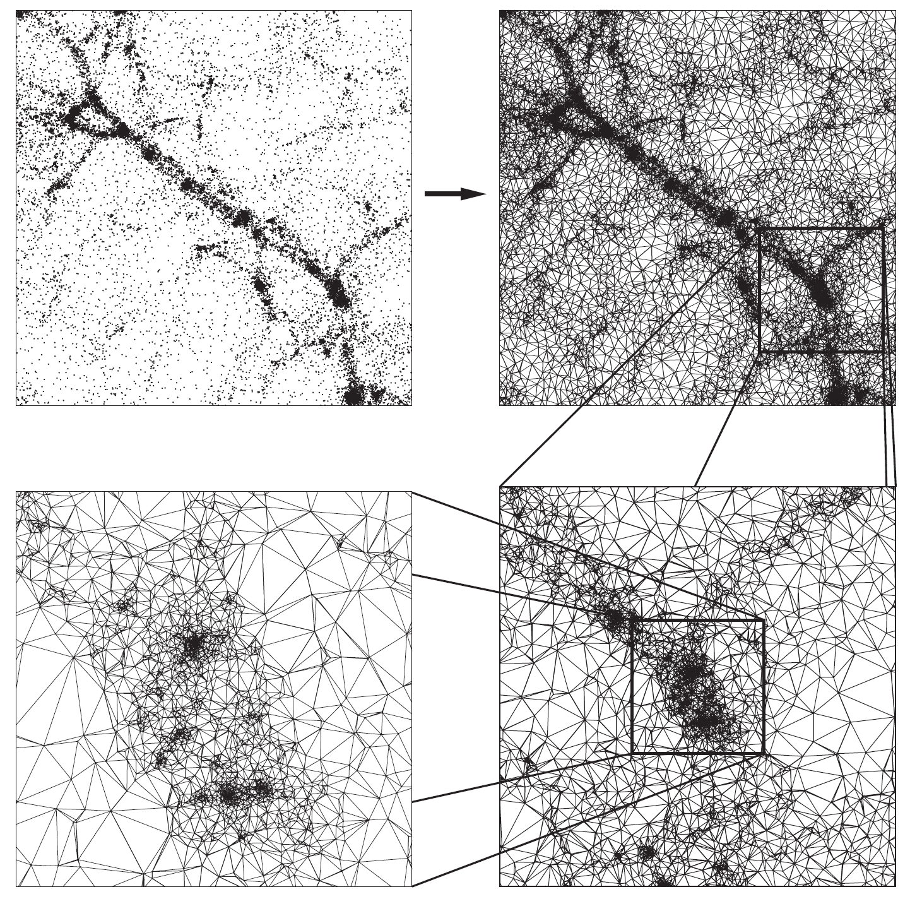
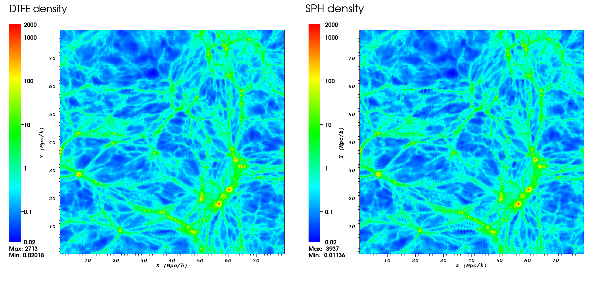
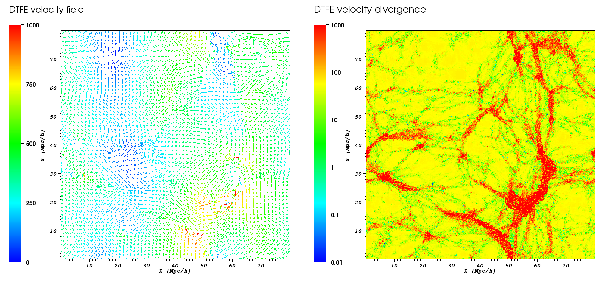

# The DTFE public software

The DTFE public code is a C++ implementation of the **Delaunay Tessellation Field Interpolation (DTFE)** method. Its purpose is to interpolate quantities stored at the location of an unstructured set of points to a regular grid using the maximum of information contained in the input points set. In particular, the code can calculate the following cosmological quantities:
* the density field - this is calculated directly from the point distribution,
* the velocity field and derivatives (e.g. gradient, divergence, vorticity) - uses the velocity at each particle position, and
* general vector quantities and their derivatives - these quantities must be given as input for each point in the set.

The code was written with the purpose of analysing cosmological simulations and galaxy redshift survey. Even though the code was designed with astrophysics in mind, it can be used for problems in a wide range of fields where one needs to interpolate from a discrete set of points to a grid.

The code was designed using a modular philosophy and with a wide set of features that can easily be selected using the different program options. The DTFE code is also written using OpenMP directives which allow it to run in parallel on shared-memory architectures.

The code comes with a complete [documentation](docs/DTFE_user_guide.pdf) and with a multitude of examples that detail the program features. A test dataset and analysis of the code output is given in the [demo directory](demo): `./DTFE demo/z0_64.gadget out --grid 64 --field density --periodic --padding 12` works out of the box (the box is periodic, and its voids are wider than the default padding of 5 particle spacings: with it about 1% of the cells would lie outside the tessellation, which the run reports).

The public release of the code is summarised in the arxiv publication [Cautun et al. (2011)](https://ui.adsabs.harvard.edu/abs/2011arXiv1105.0370C/abstract) and it is based on the method paper [Schaap and van de Weygaert (2000)](https://ui.adsabs.harvard.edu/abs/2000A%26A...363L..29S/abstract).


## The DTFE method
The Delaunay Tessellation Field Interpolation (DTFE) method represents the natural way of going from discrete samples/measurements to values on a periodic grid and it is especially suitable for astronomical data due to the following reasons:
* Preserves the multi-scale character of the point distribution. This is the case in numerical simulations of large scale structure where the density varies over more than 6 orders of magnitude.
* Preserves the local geometry of the point distribution. This is important in recovering sharp features like the different components of the cosmic web (i.e. clusters, filaments, walls and voids).
* The method does not depend on user defined parameters or choices.
* The interpolated fields are volume weighted (versus mass weighted quantities in most other interpolation schemes). This can have a significant effect especially when comparing with analytical predictions which are volume weighted.

For detailed information about the DTFE method see [Schaap and van de Weygaert (2000)](https://ui.adsabs.harvard.edu/abs/2000A%26A...363L..29S/abstract), [van de Weygaert and Schaap (2009)](https://ui.adsabs.harvard.edu/abs/2009LNP...665..291V/abstract), and [Cautun et al. (2011)](https://ui.adsabs.harvard.edu/abs/2011arXiv1105.0370C/abstract).

|  |
|:------:|
| Figure 1: *An illustration of the 2D Delaunay tessellation of a set of particles from a cosmological simulation. Courtesy: Willem Schaap.* |

|  |
|:------:|
| Figure 2: *An example of the DTFE density field form a cosmological simulation. The right panel shows the same result but now using the smoothed particle hydrodynamics (SPH) method.* |

|  |
|:------:|
| Figure 3: *A map of the DTFE computed velocity flow (left panel) and velocity divergence (right panel) corresponding to the density field shown in Figure 2.* |


## Summary of software features

* Works in both 2 and 3 spatial dimensions.
* Interpolates the fields to three different types of grids:
  + Regular rectangular and cuboid grid - useful for cosmological simulation.
  + Redshift cone (spherical coordinates) grid - useful for galaxy redshift survey or for mock observations.
  + User given sampling points - can describe any complex or non-regular sampling geometry
* Returns both the value at the centre of each cell of the interpolation grid as well as the value averaged over each cell.
* Uses the point distribution to compute the density and interpolates the result to grid.
* Each sample point has a weight associated to it to represent multiple resolution N-body simulations and observational biases for galaxy redshift surveys.
* Interpolates the velocity, velocity gradient, velocity divergence, velocity shear and velocity vorticity.
* Interpolates any additional number of fields and their gradients to grid.
* Periodic boundary conditions.
* Zoom in option for regions of interest.
* Splitting the full data in smaller computational chunks when dealing with limited CPU resources.
* The computation can be distributed in parallel on shared-memory architectures.
* A phase-space (Lagrangian) variant, `PS-DTFE`, that recovers the multi-stream structure of the cosmic web - the multi-stream density, the velocity dispersion, and the caustic surfaces.
* Exact, sampling-free field estimation as an alternative to Monte-Carlo cell averaging, and evaluation of the fields at arbitrary user-supplied points, with exact point location (a point on a shared face or vertex is counted once per stream).
* An interactive mode: the tessellation is built once and then queried from Python at any points, as often as needed (`dtfelib.Estimator`), on a snapshot file or on particles held in numpy arrays; boxes too large for one tessellation are served as a composite of partitions kept on disk.
* For every stream at a point, the Lagrangian position its matter started from, and any per-particle quantity interpolated along it.
* Automatic choice of the domain decomposition and memory footprint from the data and the machine, with an optional out-of-core mode for grids larger than the available memory.
* The tessellation can be cached on disk and reused by later runs, which skips its construction entirely when the same data is analysed again.
* Optional GPU acceleration of the field deposit on Apple Silicon (Metal) and, as a port of the same kernels, on Linux with an NVIDIA (CUDA) or AMD (HIP) GPU, covering every grid field of both estimators (density, velocity, dispersion, gradients, a scalar field and the exact deposits); and an optional double-precision build.
* For comparison purposes, the software comes also with three other simpler interpolation techniques: nearest grid point (NGP), triangular shape cloud (TSC) and smoothed particle hydrodynamics (SPH).
* Returns the Delaunay tessellation of the given point set.
* Easy change of input/output data format.
* Easy to use as an external library.
* Extensive documentation of each feature.


## Installation and Building

### Supported Platforms
- **macOS** (Intel and Apple Silicon)
- **Linux** (Ubuntu, Debian, Fedora, CentOS, RHEL, and other distributions)

### Prerequisites

#### macOS
1. **Install Xcode Command Line Tools:**
   ```bash
   xcode-select --install
   ```

2. **Install Homebrew** (if not already installed):
   ```bash
   /bin/bash -c "$(curl -fsSL https://raw.githubusercontent.com/Homebrew/install/HEAD/install.sh)"
   ```

3. **Install dependencies:**
   ```bash
   brew install gsl boost cgal mpfr gmp hdf5 fftw llvm libomp
   ```

#### Linux (Ubuntu/Debian)
```bash
sudo apt-get update
sudo apt-get install build-essential
sudo apt-get install libgsl-dev libboost-all-dev libcgal-dev libmpfr-dev libhdf5-dev libgmp-dev libfftw3-dev
```

#### Linux (Fedora/RHEL/CentOS)
```bash
# For Fedora
sudo dnf groupinstall "Development Tools"
sudo dnf install gsl-devel boost-devel CGAL-devel mpfr-devel hdf5-devel gmp-devel fftw-devel

# For older RHEL/CentOS
sudo yum groupinstall "Development Tools"
sudo yum install gsl-devel boost-devel CGAL-devel mpfr-devel hdf5-devel gmp-devel fftw-devel
```

#### Linux (Arch/Manjaro)
```bash
sudo pacman -S base-devel gsl boost cgal mpfr hdf5 gmp fftw
```

### Quick Start

The one-command way, after cloning: `./scripts/install.sh` installs any missing dependencies, builds
both binaries with the best backend for the machine (Metal on Apple Silicon, CUDA/HIP on a Linux GPU
box, else the CPU), installs the Python package and sets up the graphical launcher (`--no-gui` on a
cluster, `--cpu` to skip the GPU, `--double` for the double-precision pair); a double or 2D pair already built
is rebuilt with them. A failed compile leaves the previous binaries in place and prints the end of its build log. The steps below are what it does, by hand.

1. **Clone the repository:**
   ```bash
   git clone <repository-url>
   cd DTFE
   ```

2. **Check the platform and dependencies:**
   ```bash
   make test-platform    # shows the detected platform, compiler and paths
   make deps-check       # verifies every required header and prints the install command for anything missing
   ```

3. **Build the executables:**
   ```bash
   make DTFE             # standard DTFE
   make PS-DTFE          # phase-space DTFE (see below)
   ```
   `./PS-DTFE --version` prints the git revision and time of the build, which every run also writes into its log.

   On Apple Silicon, add `METAL=1` (e.g. `make DTFE METAL=1`) to run the volume-averaged interpolation / phase-space deposit on the GPU, with automatic fall-back to the CPU. On Linux, `CUDA=1` (NVIDIA, needs the CUDA toolkit's `nvcc`) or `HIP=1` (AMD, needs ROCm's `hipcc`; set `GPU_ARCH` to the card's architecture) builds the same deposit from a port of the Metal kernels; that port compiles (with `nvcc` and with ROCm's `hipcc`, both checked in CI) and falls back to the CPU correctly on Linux, but has not yet been validated on NVIDIA or AMD hardware, so its first run on a GPU machine should be the parity checks named in `metal/README.md`. As a shortcut, `./scripts/install.sh` installs any missing dependencies, builds both binaries with the best backend for the machine, installs the Python package (next step), and sets up the graphical launcher (see below; `--no-gui` leaves it out, e.g. on a cluster).

4. **Install the Python package** (`dtfelib`: loaders, analysis and the interactive `Estimator`):
   ```bash
   python3 -m pip install -e python
   ```
   Install it editable, so that it finds `./DTFE` and `./PS-DTFE` in the repository; otherwise point `DTFE_BIN_DIR` at the directory holding them.

5. **Build the shared library:**
   ```bash
   make library
   ```

6. **Clean build files:**
   ```bash
   make clean
   ```

7. **Run the tests** (optional):
   ```bash
   tests/ci_suite.sh core      # every CPU suite against ./DTFE and ./PS-DTFE
   ```
   `tests/ci_suite.sh` is the one list of suites that both the GitHub workflow (`.github/workflows/ci.yml`) and the Docker image run: `build` builds the single, double and 2D pairs, `double` repeats the suites against the double pair, `2d` runs the 2D suite and `gui` the launcher's tests. The GPU suites (`tests/dtfe_metal_check.sh`, `tests/gpu_scalar_check.sh`, `tests/gpu_mass_check.sh`, `tests/dtfe_gpu_retry_check.sh`) need a GPU build and are run by hand. Two suites joined `core` and `double` on 2026-10-13: `tests/dtfe_mc_average_check.sh` (the standard Monte Carlo cell average is unbiased and the same for any split; its GPU part runs only on a GPU build) and `tests/ps_periodic_seam_check.sh` (a periodic phase-space run deposits every tetrahedron exactly once across the box faces). Four more joined both with the parity batch of the same day (see Standard DTFE and PS-DTFE: the same features): `tests/dtfe_resume_check.sh` (a killed standard run resumes), `tests/ps_resume_points_check.sh` (a killed PS run with an image plane resumes), `tests/ps_point_conventions_check.sh` (image planes in the grids' conventions) and `tests/py_meanfield_test.py` (dtfelib's mean-field velocity derivatives); `tests/dtfe_auto_tune_check.sh` (the standard auto-tuner's memory plan, about 70 s) is run by hand.

   **Standard-DTFE regression.** `tests/run_tests.py` compares a periodic 1000-particle run (point density and the
   `--exact-average` cell average on a 12^3 grid) with `tests/reference/regression_periodic.txt` to 3e-4 relative,
   on macOS and in Linux CI alike: the set has no Delaunay ties, so every CGAL builds the same tessellation, and the
   tolerance sits 11x above the measured rounding spread (double build, thread count, Linux vs Mac) and below the
   smallest real change tried. After an intended change of the estimator, regenerate it with
   `python3 tests/run_tests.py --update-ref` and commit the file. `tests/ps_auto_tune_check.sh` and
   `tests/ps_scratch_check.sh` now run on Linux too (part of `tests/ci_suite.sh core`); their GPU parts skip on a
   CPU build.

### Configuration Options

The software behavior can be configured by editing the `OPTIONS` section in the Makefile:

#### Spatial Dimensions
The number of dimensions is chosen per build, without editing anything:
```bash
make DTFE          # 3D (default)
make DTFE DIM=2    # 2D
```
A 2D build is a set of its own, `DTFE-2d` and `PS-DTFE-2d` (`-2d-double` with `DOUBLE=1`), built from its
own object directories, so the 2D and 3D binaries coexist; it is CPU-only. Phase-space DTFE works in
2D since 2 October 2026 (`make PS-DTFE DIM=2`): it reads the same Gadget-HDF5 layout with two-column
`Coordinates`, `Velocities` and `InitialCoordinates` (`tests/generate_ps_test_data.py --dim 2` writes
such files), and supports the sampled and exact deposits (the exact one clips each triangle against
the cells itself), the stream counts and hidden-stream flags, the velocity, dispersion and gradient
fields, `--ps-vertex-mass`, `--ps-volume-weighted`, `--ps-halo-release`, `--ps-linear-deposit`,
`--ps-caustics` (the parity bits and the collapse multiplicity, which runs to 2 in 2D), `--partition`,
periodic and non-periodic boxes, the tessellation cache and point evaluation (`--sample-points`, with
the points as `x y` text lines or raw float64 pairs; the `.pts_*` vectors then carry two components,
the dispersion three, the velocity gradient four), `--ps-window`, and `--ps-caustic-cusps`, which flags
the cusps where a fold line turns tangent to its null direction (there is no swallowtail bit in 2D: a
swallowtail is a moment of a 2D flow, not a point of it). The standard `DTFE-2d` averages exactly too
(`--exact-average`, clipping its triangles against the cells itself), and the interactive server works
in 2D too (`--serve`; `dtfelib.Estimator(..., dim=2)` or `Estimator.from_arrays` on (N, 2) arrays, and
`grid(xs, ys)`), its handshake telling the client the dimension. `tests/ps_2d_check.sh` checks it against analytic 2D Zel'dovich flows: the stream count in every
column of a pancake, the separable stream fractions of crossed waves, the convergence of the
single-stream density and velocity, the sampled deposit converging to the exact one, point
evaluation, whose stream counts at the cell centres equal the grid's exactly, the window against the
full run, the cusp flag against the two analytic cusps of a pancake modulated along y, and the exact
average against a perfect lattice. Until then a
2D build refused to compile: its input could not be read (a 3D file overran the 2D reader) and its
deposit had reported 62 streams where at most 3 exist. The T-web works in 2D too since 3 October 2026
(the same FFT Poisson solve; two eigenvalues, so the classes are 0 void, 1 filament, 2 node), checked by
`tests/tweb_check.sh` as in 3D plus an independent numpy solve of crossed waves for the cross term; the
GPU and the parallel triangulation stay 3D only. The graphical launcher runs 2D snapshots as well (see
below).

#### Variable Precision
The precision is chosen per build as well:
```bash
make DTFE PS-DTFE                   # the single-precision pair (default): ./DTFE, ./PS-DTFE
make DTFE PS-DTFE DOUBLE=1 METAL=1  # the double-precision pair as well: ./DTFE-double, ./PS-DTFE-double
```
`DOUBLE=1` keeps every position, density, field and accumulator in double precision, from the
input read onward -- the Gadget-HDF5 reader then keeps the full precision of snapshots that store
their coordinates in double (IllustrisTNG does), which the default build rounds on read -- and
writes the output grids as float64 (`dtfelib` and the launcher read either). It costs about twice
the memory. The double pair is a separate set of binaries built from its own object directories
(`o_d/`, `o_ps_d/`), so both precisions coexist: the run scripts pick the pair with
`DTFE_PRECISION=double`, the launcher with its precision setting, and `scripts/install.sh --double`
builds it next to the single one. The GPU is available to it: the GPU kernels (Metal, CUDA, HIP) are single
precision, so a double build hands the GPU float copies of its tetrahedra and adds the float sums
into its double grids, while reading, triangulation, densities, point evaluation and the CPU
deposits stay double. The exceptions are the PS deposit's grids: the mass grid (the density; since 2026-10-08 on the
Metal GPU, 2026-10-11 on the CUDA/HIP port, validated through its CPU emulation, and 2026-10-12 on the CPU) and, since
2026-10-14, every moment grid (velocity, dispersion and its own mean and weight, velocity and scalar gradients, the
exact and the released multiplicities) are exact 64-bit fixed-point sums. A pass's GPU and CPU deposit use the same
units, so its grids are identical from run to run whatever the order of the GPU's atomic adds and, in the single
build, whatever the CPU thread count; a double build converts the GPU's words to double once, while its CPU deposit
keeps its double sums (equal between thread counts to ~1e-12, not bit for bit). `PS_METAL_FLOAT_MOMENTS=1` /
`PS_GPU_FLOAT_MOMENTS=1` bring back the float moment sums, and `PS_METAL_FLOAT_MASS=1` / `PS_GPU_FLOAT_MASS=1` the float
mass grid, for comparison. Standard DTFE's GPU '_a' grids are exact 64-bit sums as well since 2026-10-13, but a double build receives them rounded to float.
A share that has no 64-bit integer (a NaN, an infinity, or a product beyond 2^63 units) used to be converted anyway,
with a result the C++ standard leaves open (0 on Apple Silicon, the most negative integer on x86-64), so it could
corrupt an exact sum silently where a float sum would have shown a NaN. Since 2026-10-15 every deposit, CPU, Metal and
CUDA/HIP alike, leaves such a share out and counts it, by grid, and the run ends with one warning naming each grid and
how many of its shares were dropped (normal data never meets this: its grids are unchanged, bit for bit). The test
hook `DTFE_TEST_NAN_SHARE=<k>` gives about one tetrahedron in k a NaN mass (PS-DTFE) or NaN vertex densities (the
standard GPU deposit) to show it (`tests/ps_fixed_moments_check.sh` F5, `tests/dtfe_gpu_retry_check.sh` N1). A PS-DTFE split run adds its partitions' grids into the result in partition
index order by default since 2026-10-14 (the staged ordered merge, see Long runs), so its merged grids are the same
from run to run too; with `--completion-order-merge` and several partitions in flight (`--max-concurrent` above 1)
they differ in the last bits, the merge then adding the partitions in the order they finish. `tests/ps_double_check.sh` compares the two pairs on the same snapshot: the
grids agree the way two single-precision paths do (a few borderline samples change cell), stream
counts and caustic flags are identical, and the double pair's GPU deposit matches its own CPU run
like the single build's. Every suite that runs the programs also runs against the double pair:
`DTFE_TEST_PRECISION=double tests/<suite>` (or `tests/ci_suite.sh double`) points it at
`./DTFE-double` / `./PS-DTFE-double` and reads their float64 grids, with the same checks as the
single pair; only the comparisons of the GPU's stream counts and caustic flags with the CPU's exact ones allow one
cell in ten thousand to differ there, since the GPU works on float copies of the double tetrahedra: its error
bound covers its own float arithmetic but not the rounding of the double vertices to float, so a sample within
that rounding of a face can be placed on the wrong side (2026-10-13; the double binary of 2026-10-12 already did
this at another padding, and the exact match of the tests had held only because CGAL numbered the vertices the
same way). The single-precision build's GPU and CPU stream counts and caustic flags stay identical.

The sampled deposit no longer tests a one-cell ring of samples around each tetrahedron's bounding box (2026-10-11): every sub-sample lies inside its own cell, so the ring could never hold one. The grids are byte-identical (the velocity moments to the GPU's run-to-run rounding) and the deposit kernel is 1.5-2.3x faster on synthetic 256^3 runs (the CPU deposit gains about as much). A column-by-column enumeration of the samples inside each tetrahedron was measured as well and left off: it was slower on three of four synthetic cases and 1.34x on the most stretched one.

#### Computed Quantities
```makefile
OPTIONS += -DVELOCITY          # Enable velocity computations
OPTIONS += -DSCALAR            # Enable scalar field interpolation
OPTIONS += -DNO_SCALARS=1      # Number of scalar components
```

#### Input/Output Defaults
```makefile
OPTIONS += -DINPUT_FILE_DEFAULT=105   # HDF5 gadget format
OPTIONS += -DMPC_UNIT=1000            # Data units (kpc in this example)
OPTIONS += -DOUTPUT_FILE_DEFAULT=101  # Binary output
```

#### Additional Features
```makefile
OPTIONS += -DOPEN_MP              # Enable OpenMP parallelization
OPTIONS += -DTEST_PADDING         # Validate Delaunay tesselation padding
OPTIONS += -DREDSHIFT_SPACE       # Enable redshift space computations
OPTIONS += -DTRIANGULATION        # Enable triangulation access
```

See the Makefile for the complete list of available options.


### Corrections of 2026-10-11 that change outputs

**Interlacing.** The second pass grids the box moved by half a cell. Since 2026-10-11, periodic runs do this by moving the particles by -dx/2, which works for every estimator, including PS-DTFE, which has no --region. Before that, a run without --region gridded the same cells twice: the output was a smoothed copy moved half a cell, not de-aliased, so regenerate any interlaced grid. Without --periodic, --interlace needs a --region half a cell inside the box. The T-web is computed from the first pass's density.

**Mass assignment.** Every kernel gets periodic images of at least its reach: 1 cell for CIC/TSC/NGP, 2 for PCS. At a face or partition seam, a kernel uses its stencil clipped to the grid. Since 2026-10-11, PCS and periodic CIC grids are exact on a uniform lattice at faces and seams, and PCS deposits are centred on their particle. Regenerate earlier PCS and CIC grids.

**Input checks.** A snapshot whose Coordinates have the wrong number of columns for the binary (3 for DTFE-2d / PS-DTFE-2d, 2 for DTFE / PS-DTFE) is refused, and the message names the binaries to use. Before 2026-10-11 such a run crashed, or wrote a garbage grid at exit 0.

**Boxes.** Fractional --region and --padding are converted per axis, so non-cubic and off-origin --box values work. Before 2026-10-11 the z axis took the x length.

### Corrections of 2026-10-13 that change outputs

An audit of both production grid sets (the 27 TNG snapshots of 2026-10-12) found the following; each is described in full where its subject is.

**Standard DTFE: the Monte Carlo cell average was biased.** The default '_a' average lost 0.17-0.29% of the mass in the standard grids at z <= 2 (TNG100-3-Dark z = 1: box mean 0.99757; less at high redshift, 7e-5 at z = 20), and its realization changed with the thread count and the `--partition` split. It is now unbiased and split-independent, so every sampled standard '_a' grid changes by about 8% rms per cell (a new realization); `--exact-average` grids are unchanged to the last bit. Production standard DTFE uses `--exact-average` from now on (`run_dtfe.sh`'s default, `thesis_runs.sh dtfe27`); the standard grids made before 2026-10-13 carry the bias until they are replaced. See Field evaluation methods.

**PS-DTFE: `.caustic` marks every cell a folded tetrahedron overlaps**, not only the cells where one deposited a sample: 33.6% of the cells of TNG100-3-Dark at z = 1 instead of 21.0%. Existing grids need no rerun: `FieldSet.fold_mask()` rebuilds the flag from `.streams` and `.hidden_streams`. See Phase-Space DTFE.

**PS-DTFE: the periodic seam.** A periodic run deposited some tetrahedra twice and others not at all within a few cells of the box faces (up to 394 double-covered and a few dozen uncovered cells per snapshot, a box-mass offset of 1-2e-7). Fixed on synthetic boxes; the TNG grids keep the defect until they are rerun, and every periodic PS tessellation cache is rebuilt once. See Periodic seam below.

**Standard point evaluation pads with 15 spacings** (`dtfelib.Estimator`, the launcher's standard server and exact zoom, and the Custom tab's standard runs), not the binary's 5, which left up to ~1% of points near a box face off by up to 4%. A `--region` run is planned by the auto-tuner from its own particles (a launcher exact zoom of TNG50-3-Dark: one domain instead of `--partition 3 3 3`). See Interactive point evaluation and Automatic memory management.

**The drivers default to the production settings**: 512^3, the GPU on a GPU build, the T-web and V-web, the exact cell average for standard DTFE, the caustic classes and volume-weighted moments for PS-DTFE; a rerun moves the files of the old run that it does not rewrite into `<prefix>.superseded/`. See the knob table under Running on TNG snapshots.

The parity batch of the same day (the two binaries given the same run machinery; see Standard DTFE and PS-DTFE: the same features) changes these outputs:

**Standard DTFE: the GPU grids are exact sums.** The `--gpu` '_a' grids are 64-bit fixed-point sums, so two GPU runs write byte-identical grids (before, 25-49% of the cells differed by up to ~1e-6); against older GPU grids they move only at that level, and CPU grids are unchanged. See Standard DTFE's GPU interpolation under Long runs.

**Standard DTFE: image planes of a split run.** A standard `--sample-points` run that the auto-tuner split into partitions (only an explicit `--partition` was refused) gave wrong point values without a warning: on the demo snapshot at z = 0, split 5x5x5 under a 0.25 GB budget, `.pts_den` was off by up to 34% of the peak at 109,123 of 262,144 points while `.pts_streams` read 1 everywhere. The binary now answers the points partition by partition, equal to one triangulation to floating-point rounding. No production plane exists for standard DTFE, so nothing on the data disk is affected. See Field evaluation methods.

**PS-DTFE: image planes follow the grids' conventions.** With `--ps-vertex-mass` and `--ps-volume-weighted`, the production flags, every `.pts_*` density, velocity, gradient and per-stream record changes: on a synthetic box with TNG-like initial positions at z = 20 a plane's density contrast was 0.77-0.79 times the grid's and is now 0.97-0.99 times. The 27 production planes keep the old estimators until they are rerun; `--pts-conventions legacy` reproduces them. See Field evaluation methods.

**PS-DTFE figures: velocity derivatives of the mean flow.** plot_velDiv_den.py, plot_cosmic_web.py, plot_web_streams.py, plot_shear_triaxial.py, plot_DTFE.py --method ps and plot_halo_tracking.py now take PS-DTFE's divergence, shear and V-web from the gradient of its velocity grid, the quantity standard DTFE stores, instead of the stored stream average ⟨∇v⟩. Their PS figures and tables change: on a synthetic shell-crossed box the divergence's box mean goes from +8.4 to 0 km/s/Mpc and the V-web filament fraction from 2.8% to 4.0%, against standard DTFE's 4.6%. No grid changes and no rerun is needed; `--ps-gradient stored` gives the old figures. See Phase-Space DTFE.

### Corrections of 2026-10-14 that change outputs

**PS-DTFE: every grid is an exact sum.** The velocity, dispersion and gradient moments, their weights and the exact
and released multiplicities are 64-bit fixed-point sums on the GPU and the CPU, like the mass grid, so they no longer
depend on the order of the GPU's atomic adds or on the CPU thread count. Against the grids made before, every moment
grid moves at float rounding (about 1e-6 of the peak on synthetic data), more in cells with heavy accumulation, where
the new GPU grids are closer to the CPU's (on strongly folded test waves the GPU dispersion sits within 2-5e-7 of the
CPU's, the float atomics 3.2-3.5e-5); under `--ps-exact-deposit` the GPU's `.a_den` moves at rounding too. A double
build converts the GPU's words to double, and its volume-weighted dispersion weight is the mass grid. A GPU partition's
grids take 188 B per cell instead of 104, on the device and again in the host's copy (the auto-tuner counts it: about +0.5 GB per partition at 512^3 split 5x5x5, +0.3 GB at the
6x6x6 of the 2026-10-12 production runs), so a
production run may get another plan; the CPU deposit's threads no longer keep private copies of these grids (peak
2.38 -> 0.83 GB on a 10-thread test). `PS_METAL_FLOAT_MOMENTS=1` / `PS_GPU_FLOAT_MOMENTS=1` restore the float sums.
See Variable Precision.

**PS-DTFE: partitions merge in index order by default.** Partitioned runs with several partitions in flight move at
float rounding (~1e-7 relative) against a completion-order run of the same settings, and are now the same from run to
run, byte-identical to the old `--ordered-merge` and to `--max-concurrent 1`. See Long runs.

**Standard DTFE: partitioned image planes are checkpointed**, so a killed `--sample-points` run resumes; its outputs
are unchanged.

## Phase-Space DTFE

Standard DTFE builds the Delaunay tessellation in Eulerian (present-day) space and returns a single-valued density at each point. **Phase-Space DTFE** builds the tessellation in Lagrangian (initial-condition) space and follows it as it is deformed to the present day. Because the deformed tessellation can fold over onto itself, the method recovers the *multi-stream* structure of the cosmic web: the density at a point is the sum over every stream (folded simplex) that covers it, and the number of streams is returned as a field of its own. This makes it especially suited to caustics and to the multi-stream interiors of voids, where the single-stream estimate breaks down. The method follows the phase-space tessellation approach of Abel, Hahn & Kaehler (2012) and Shandarin, Habib & Heitmann (2012).

Phase-Space DTFE is built as a separate `PS-DTFE` executable (the `-DPHASE_SPACE` compile option, set automatically by the target so that it can coexist with the standard build):
```bash
make PS-DTFE            # add METAL=1 on Apple Silicon (CUDA=1 / HIP=1 on Linux) to run the deposit on the GPU
```

It needs **two positions per particle** — the present-day (Eulerian) position and the initial-condition (Lagrangian) position — read from a Gadget-HDF5 file, either from an `InitialCoordinates` dataset in the same file or from a separate initial-conditions snapshot given with `--lagrangianInput`:
```bash
./PS-DTFE snapshot.hdf5 output_root --grid 256 --periodic --field density --lagrangianInput ics.hdf5
```

In addition to the standard fields, `PS-DTFE` returns the number of streams per cell, the velocity dispersion (its trace and the full symmetric tensor), and, optionally, the caustic structure of the map (`--ps-caustics`). Because the map of each tetrahedron is linear, its deformation tensor is constant inside it and known exactly, which gives both the fold surfaces — where the orientation of the map flips — and, alongside them, the number of principal axes along which the sheet has already collapsed: one for a wall, two for a filament, three for a node. Cells where two of the deformation eigenvalues coincide, the neighbourhood of an umbilic point, are flagged as well. The higher singularities of the caustic skeleton proper — the cusps — require in addition the derivative of the critical eigenvalue along its own eigenvector, which does not exist inside a tetrahedron where the deformation is constant; `--ps-caustic-cusps` estimates it from the neighbouring tetrahedra and reports the result as a further flag. The estimate is made over all tetrahedra sharing a vertex with the one in question, which matters: fitted from the four face neighbours alone it marked several per cent of the fold cells of a one-dimensional wave that has no cusps at all, and over the wider ring that falls to one cell in ten thousand. It is left switched off unless asked for, since the wider stencil is not free. The same neighbourhood answers the next question in the hierarchy at almost no extra cost, and the flag reports that too: where a cusp is a point at which the critical eigenvalue stops varying along its null direction, a swallowtail is one at which its curvature stops as well, so the estimate fits a cubic along that direction and asks whether the expansion begins only at third order. The separation this achieves is honest but modest — on waves whose singularities are known exactly, a true swallowtail lights some seventeen per cent of the cusp cells, a cusp that is genuinely not one lights one and a half, and an ordinary fold lights none — and it cannot be improved by tightening the test, because a swallowtail is a point rather than a surface and what is really being marked is the neighbourhood of one, over a band as wide as the stencil that measures it. Two refinements of the mass assignment keep the estimate accurate on evolved initial conditions: chart-independent tetrahedron masses (`--ps-vertex-mass`, which distributes each particle's mass over its incident tetrahedra) and volume-weighted velocity moments (`--ps-volume-weighted`, the volume-weighted convention used by standard DTFE). Inside virialised haloes, where the stream count is no longer converged, the thoroughly mixed sheet can be released from the deposit with `--ps-halo-release` following Stücker et al. (2021). The caustic flags can be computed inside the main run instead of in a run of their own: on TNG100-3-Dark at z = 1 (512^3, all fields, a 4096^2 image plane) `--ps-caustics` added 2.2 minutes to a 6.7-minute run (+33%) and 1.2 GB to its peak memory, and left every other grid unchanged to float rounding and the image plane bit for bit (2026-10-12).

**The fold flag is geometric (2026-10-13).** `.caustic` marks a cell when tetrahedra of both orientations overlap it. Until 2026-10-13 the negative-orientation half was set only where a folded tetrahedron deposited a sample, so every fold thinner than the sampling was missed: on TNG100-3-Dark the flag marked 21.0% of the cells at z = 1 where folded tetrahedra overlap 33.6% (24.9 against 36.1% at z = 0, about half the true fraction at z >= 3), and the count changed with `--avg-subsamples`. It now comes from the same exact overlap test as bit 1 of `.hidden_streams`, so `.caustic` is the same for any `--avg-subsamples`, for the exact deposit, for any `--partition` split and on the GPU, and equals the cells where `.streams` exceeds one or bit 1 of `.hidden_streams` is set. The other bits of `.causticClass` (the collapse multiplicity in bits 2-5, the umbilic indicator in bit 6, and the cusp and swallowtail indicators in bits 7-8) are still recorded at the deposited samples. They depend on the sampling, and a fold cell whose samples all missed the thin folded layer shows only the collapse of the streams around it, usually k = 0, so the fold fraction can now exceed the k >= 1 (sheet) fraction; the cusp bits can also differ between a serial and a `--partition` run in a few cells. Grids written before the fix need no rerun for the fold: `FieldSet.fold_mask()` in dtfelib (`caustic_is_fold(mask, streams=..., hidden=...)`) rebuilds the exact flag from `.streams` and `.hidden_streams`, and plot_caustic_skeleton.py and plot_web_streams.py use it. It is exact in periodic runs and conservative in non-periodic ones; on grids made before the periodic-seam fix (see Periodic seam) it also counts the few hundred cells near the box faces that the seam covered twice. The launcher's Explore map of the fold cells uses the same exact flag for periodic runs, so existing grids show it too (a non-periodic run shows its stored `.caustic`).

**Velocity gradients in multi-stream regions.** In a cell crossed by several streams, PS-DTFE's velocity gradient and everything derived from it (`.velDiv`, `.velShear`, `.velVort`, the V-web) is the average over the streams of each stream's own gradient, weighted by the stream's volume in the cell (by its mass without `--ps-volume-weighted`). It is not the gradient of the mean velocity that standard DTFE computes. The two agree in single-stream cells (deep in voids to 1.5%) but not in folds: inside a wall the inverted stream has a positive divergence while the mean flow converges on the wall. So the box mean of the PS divergence is not zero, as standard DTFE's is; with volume weights, the box mean of divergence x streams is the growth rate of the total stream volume. On TNG100-3-Dark at z = 1 the PS V-web finds 1.78% filaments and 0.005% nodes, against 6.62% and 0.20% for standard DTFE (voids 62.9 against 54.2%). Compare the two estimators' *stored* gradients in single-stream cells only (`velocity_single_stream()` / `single_stream_mask()`); a divergence-density relation from the stored PS divergence needs an intercept or that mask (multi-stream cells add +12 to +56 km/s/Mpc). For the quantity standard DTFE stores, dtfelib computes the mean field (2026-10-13): `FieldSet.load(name, mean_field=True)` returns the divergence, shear, vorticity, gradient and V-web of the mean velocity for both estimators. Standard DTFE's stored grid comes back unchanged; for PS-DTFE they are the FFT derivatives of its `.a_vel` grid, in the binary's component order and units, with its V-web normalisation, −sqrt(a)/(2·100h)(g + gᵀ), and the run's own `--lambda_th` from its run log. Applied to a standard run's own `.a_vel`, it reproduces the binary's `.a_velDiv` to a correlation of 0.995-0.998 and its V-web class in 96.5-98.4% of the cells (`tests/py_meanfield_test.py`); on a PS run the divergence's box mean is zero again. plot_velDiv_den.py, plot_cosmic_web.py, plot_web_streams.py, plot_shear_triaxial.py, plot_DTFE.py and plot_halo_tracking.py use it for PS-DTFE by default, and so does the launcher's Explore tab since 2026-10-15 (one slice at a time: `fields.mean_field_plane`, below); `--ps-gradient stored` restores the stored PS grids, and plot_web_streams.py and plot_halo_tracking.py then add `_stored` to their file names. Memory at 512³ (float32): divergence about 3.2 GB, V-web about 6.5 GB, the 9-component gradient about 7.5 GB. One plane costs far less (`fields.mean_field_plane`, 2026-10-15): the spectral derivative along an axis is a periodic convolution of each line of the grid with the fixed kernel irfft(i k), so the derivatives on a plane normal to that axis are 1-D FFTs of the plane itself and, for the normal one, that kernel summed along the line through each pixel, in one pass over the velocity grid in 16 MB slabs (about 100 MB in all at 512³); it is the whole-cube result cut there to float rounding (`tests/py_meanfield_test.py`, every name and axis) and takes 0.3-0.6 s at 512³ with the velocity grid in memory (measured on a loaded machine). On a snapshot with both grid sets dtfelib, and so plot_velDiv_den.py, takes the PS-DTFE grids (`--method dtfe` for the standard ones). An image plane's `.pts_velGrad` stays the stream average: a plane holds no derivatives out of itself, so it has no mean-field version. The mean field has not been checked on TNG yet.


The stream count on the grid is measured the way the fields are, at the sub-samples of each cell (`--avg-subsamples`): it is the number of streams covering a sample, averaged over the cell, and it converges to the volume-weighted stream count as the sampling is refined. A tetrahedron smaller than the sample spacing can contain no sample at all. Its mass is still deposited, in the cell holding its centroid, so mass is conserved exactly, but it adds nothing to the count, which is what keeps the count unbiased; the stream count on its own cannot see a fold thinner than the sampling, so a separate output, `.hidden_streams`, marks the cells that hold multi-stream volume their count misses (exactly: a folded tetrahedron overlaps the cell), and, as a second bit, the cells that received such a sub-sample tetrahedron's mass. A single-stream mask should use both, `.streams` equal to one and bit 1 of `.hidden_streams` clear; `velocity_single_stream()` in `dtfelib` does this. The flag is conservative: it also marks cells in which the unsampled tetrahedron belongs to the one stream that is there, which happens throughout the voids when the tessellation is finer than the sampling. Which tetrahedra contain a sample is decided exactly, by the test described under point evaluation below, so with one sample per cell the grid count is the exact number of streams at the cell centre, in every cell, and a `--partition` split gives the same count as a serial run. When every unsampled tetrahedron was counted as a stream, 11.6% of the cells of a crossed-wave test were too high, by up to 839, and the floating-point inside test that preceded the exact one miscounted a few cells per million. The GPU deposit (`--ps-gpu`) reaches the same decisions: it has no double precision, so it classifies each sample in single precision against a rigorous bound on its rounding error and hands the few tetrahedra it cannot decide that way, those with a sample within rounding distance of a face, to the CPU's exact test; its stream counts are identical to the CPU's (in the single-precision build; the double build's GPU may differ in one cell in ten thousand, see Variable Precision). Its mass grid is exact as well (2026-10-08): each deposit is added as a 64-bit fixed-point integer, so the sum no longer loses the small shares that float32 drops in cells receiving millions of them (the TNG50-3-Dark z = 0 grids made before this have a box mean of 0.99941 instead of 1) and is the same from run to run whatever the order of the GPU's atomic adds; `PS_METAL_FLOAT_MASS=1` brings back the float grid for comparison. Since 2026-10-14 every moment grid is such a sum too, the velocity, dispersion and gradient moments and their weights, each in its own unit from a bound on what the pass can deposit into it, so every grid of a pass is the same from run to run (`tests/ps_fixed_moments_check.sh`; `PS_METAL_FLOAT_MOMENTS=1` brings back the float sums); the CUDA/HIP port has the same fixed-point mass grid since 2026-10-11 and the moment grids since 2026-10-14. Since 2026-10-12 the CPU's part is exact too. The tetrahedra the GPU hands to the CPU's exact test, and a whole partition the CPU deposits when the GPU gives up, used to be added in float32 into cells already holding the GPU's sum, where the smallest shares rounded away: on TNG50-3-Dark the box mean was 1 - 1.4e-5 at z = 0.5 and 1 - 8.1e-5 at z = 0, the loss sitting in the partitions with the largest haloes (one lost 1.2% of the mass the GPU had deferred to the CPU). The CPU now adds the same 64-bit fixed-point shares into the GPU's integer grid, or into its own when it deposits the whole partition, and converts to float once at the end, so the mass grid is exact and identical for any thread count; `PS_METAL_FLOAT_MASS=1` / `PS_GPU_FLOAT_MASS=1` bring back the float sums on both sides. With `--ps-volume-weighted` the dispersion is normalized by this exact mass, so dispersion grids move slightly against older runs. `PS_MASS_AUDIT=1` prints each partition's mass balance (owned particles, tetrahedra, GPU, CPU, grid) and the run's, which is how the loss was found; unset, it changes nothing (`tests/ps_mass_exact_check.sh`).

Whether a tetrahedron is too flat to be inverted is decided relative to its own size, not against a fixed volume, so the result does not depend on the length unit or on the size of the box: the same snapshot scaled into a 1 Mpc box used to lose a fifth of its mass to that test, and now conserves it exactly.

A `--box` region cut from a larger particle cloud keeps exactly the mass that lies inside it. A tetrahedron crossing the region's face deposits only its share inside: its samples beyond the face are counted but not deposited, and in the exact deposit its pieces inside the region are weighed against the whole tetrahedron. It used to give its entire mass to the part inside, so the cells along the faces of a region cut from a TNG100 box held three times the density of their neighbours, and where tetrahedra span many cells the excess reached well into the region. A region now reproduces the same cells of a larger grid to the last digit.

The Lagrangian domain of a non-periodic cloud is its alpha shape rather than its convex hull: only tetrahedra whose Lagrangian circumradius is at most three mean particle spacings are kept (`--ps-alpha-shape`, 0 keeps the whole hull). Interior tetrahedra of lattice-like initial conditions never exceed about 0.9 spacings, in jittered lattices and in TNG100-3 alike, so the cut touches only the boundary. What it removes are the flat slivers that fill the space between the nearly planar faces of the cloud and its hull, joining particles up to a whole face apart, together with the tetrahedra that bridge concavities, such as particles missing from a cut region. Neither is a flow element: their Eulerian images stretch across the cloud and deposit spurious mass and streams wherever they pass. They are also why a non-periodic run split with `--partition` used to differ from a single triangulation along the partition seams, since the hull of a face is a global object that each partition built differently. A tetrahedron within the cut, by contrast, belongs to a partition's triangulation exactly when it belongs to the global one, and the partitions are padded accordingly, so split and single runs now agree to the rounding of their sums. The boundary layer beyond the cut is the price: about half a percent of the mass of an isolated 24³ clump.

Two costs that dominate small runs were cut. The vertex densities are now summed over the cells, each adding its volume to its four vertices, instead of walking every vertex's incident cells and recomputing each cell's volume four times: 0.6 s → 0.14 s for a 0.26M-particle box in `PS-DTFE`, 0.25 s → 0.02 s in `DTFE` (the sums run in double and in a different order, so a density can move in its last float bit). And `PS-DTFE` can build its Delaunay triangulation in parallel (`--parallel-triangulation`, when the `tbb` library was present at build time; `make` detects it, `TBB=0` leaves it out): it uses the performance cores, at most six (`DTFE_TBB_THREADS` overrides: the lock-coupled insert gains nothing from more, and a thread on an efficiency core stalls the rest), shared among the tessellations being built at the same time, so a partitioned run, which already keeps every core busy, inserts as before and only its tail gains. For a small set — below two million particles — the tuner also predicts whether splitting the set into eight or twenty-seven partitions, each triangulated on its own core, beats one triangulation, and splits only for a clear gain: a 0.26M-particle slice takes 1.4 s instead of 2.4 s, its 16.8M point values 4.2 s instead of 5.3 s, while grids, whose deposit already uses every core (and on the GPU serialises anyway), stay in one domain. Such a split merges its partitions in a fixed order, so two identical runs still agree bit for bit; `--partition 1 1 1` asks for one tessellation when the bits of a single-domain run are wanted, for instance to compare with the query server. The parallel insert is off by default because its vertex and cell order differ from run to run, which moves every floating-point output between two identical runs at the level of rounding — the stream counts and the tessellation itself do not change — whereas the sequential insert reproduces bit for bit, which the query server, the tessellation cache and the test suites rely on. With the flag a 0.26M-particle slice takes 1.4 s instead of 2.4 s, and the 27-partition TNG region's GPU grid 110 s instead of 135 s; a partitioned run with more than one concurrent partition was never bit-reproducible, so there the flag costs nothing. The standard `DTFE` binary keeps the sequential insert: its clustered Eulerian points built four times slower in parallel, where the near-lattice Lagrangian points of `PS-DTFE` build about twice as fast.

The CPU deposit of `PS-DTFE` runs on every core by giving each thread its own copy of the accumulators, summed at the end; those copies are capped at a fifth of the memory, so on a fine grid, where one copy of the density and velocity accumulators is 24 GB at 1024³, the cap left a single thread. When the copies would leave fewer than half the threads, the deposit now divides the grid into slabs along x instead: each thread takes whole slabs as it comes free and writes only their cells, walking each slab's tetrahedra in the order of the single-threaded loop, so every cell receives its contributions in exactly that order and the result is identical, bit for bit, to a single-threaded deposit at any thread count (`tests/ps_slab_deposit_check.sh` compares every output file for every deposit variant). The slabs are cut where the estimated work, not the width, is equal, so a clustered box does not leave one thread with its halos. A 0.26M-particle box on 1024³ deposited in 65 s instead of 245 s, faster than the GPU's 160 s; on 768³ in 28 s instead of 64. `DTFE_DEPOSIT_SLABS=1` forces the slabs and `0` forbids them, `DTFE_DEPOSIT_THREADS` sets the thread count.

## Phase-space density

The distribution function of a collisionless sheet cannot be tabulated: it is a sum of delta
functions, one per stream. Standard DTFE therefore offers an *approximation*, `--approxPSD`, which
builds a second Delaunay tessellation in velocity space and multiplies the spatial and velocity
densities, f ≈ ρ(x)·g(v) — a factorisation that is reasonable in a cold, single-stream flow and
breaks down exactly where streams cross. Phase-Space DTFE needs no such assumption: it resolves
the streams themselves, so the exact distribution function is the per-stream decomposition it
already reports (`--sample-points --per-stream`), and the usual scalar proxy Q = ρ/σ³ follows from
the multi-stream density and dispersion it deposits (`dtfelib.fields.pseudo_phase_space_density`).
Running the two against each other measures how far the factorised estimate drifts in the
multi-stream regions where the phase-space structure actually matters.

## Field evaluation methods

The value assigned to a grid cell can be either the field at the cell centre or the field averaged over the cell volume; the volume average is normally estimated by Monte-Carlo sampling (`--method`, `--samples`). Two alternatives remove the sampling noise entirely:

* **Exact volume averaging** (`--exact-average`, standard DTFE) integrates the linear DTFE interpolant analytically over every grid-cell/tetrahedron intersection using the vendored [r3d](third_party/r3d/README.md) library (Powell & Abel 2015); with `--gpu` the clipping runs on the GPU (a float32 port of r3d that agrees with the CPU to float rounding, 6.6 times faster than the CPU's exact average on a 0.26M-particle box at 256³). For a linear field the integral over each intersection is its centroid value times its volume, so the averaged field carries no sampling noise at any resolution. Against the sampled average it costs time even on the GPU: a whole 512³ TNG run took 1.14 times as long on TNG50-3-Dark at z = 0 (1600 against 1404 s) and 1.65 times on TNG100-3-Dark at z = 1 (631 against 381 s, about 1.5 after allowing for another run on the machine). Since 2026-10-13 it is standard DTFE's production setting (`run_dtfe.sh` uses it unless `DTFE_EXACT_AVERAGE=0`): its box mean is 1 to 3e-8 on TNG100-3-Dark, and a `--partition` or thread split changes a cell by at most 3e-6.
* **Exact conservative deposit** (`--ps-exact-deposit`, PS-DTFE) does the same for the phase-space deposit: each stream is clipped analytically against the grid and deposits its mass exactly, with the velocity and dispersion following from the linear profile over each intersection. An intermediate option, `--ps-linear-deposit`, keeps the sampled deposit but weights each sub-sample by the linear density profile inside its stream.
* **A window of the grid** (`--ps-window x0 x1 y0 y1 z0 z1`, PS-DTFE, coordinates in Mpc) deposits, allocates and writes only the cells of the full `--grid` inside that box. The tessellation is the full run's (periodic or not, with or without `--partition`) and so is every stream's normalization, so the window's cells are the full run's: for the sampled deposit the same values (a stream straddling the window edge counts all its sub-samples and deposits the part inside), its counts and masks bit for bit and its sums to the last unit of their fixed-point sums, to float rounding for the exact deposit (only the window's cells are clipped and each stream is normalized by its whole weight, which equals the sum over all its pieces to double rounding). Since 2026-10-15 a window pass takes its fixed-point units from the tetrahedra that reach the window, on the GPU and on the CPU alike (before, the CPU bounded every tetrahedron of the partition and the GPU only the window's, so the two rounded differently): the units are finer in the window's small cells, a GPU and a CPU window of one pass add the same integers for the same shares, and a share far below a cell's total may round to a different last unit than in the full run (at 1e-10 of the peak on the test waves, in the velocity gradient; it was bit for bit before). The full run's units on the GPU would have cost the vertex-degree pass that its window skips (about half a window's deposit) and a filter pass over every tetrahedron. The cost scales with the window, not the grid: a 4096³ grid over a 100 Mpc box windowed to one 512² slice holds a quarter of a million cells and runs in seconds after the tessellation. A box beyond the periodic edge wraps. With `--tessellation-cache` and `--partition`, a window run loads the cached partition tessellations instead of rebuilding them and skips every partition whose occupancy map (written beside its tessellation by the query server or by an earlier partitioned run) shows that its streams never reach the window: on TNG100-3-Dark (94 million particles, 4×4×4 partitions cached by the query server) a 512² exact window processes 12 of the 64 partitions and takes about 15 s, where it took about an hour before. Three things make that possible beyond the skipping. A partitioned run with a cache records the totals it derives from all particles (their number, the mean density and the bounding box of their initial positions) beside the partitions, so a later window run whose partitions are all cached does not read the snapshot at all (16 s and 12 GB of memory on TNG100-3-Dark), and reads it after all only if a partition it needs turns out to be missing. On the GPU, the vertex masses of `--ps-vertex-mass` are counted only for the tetrahedra that reach the window, which halves each partition's deposit. And the cached tessellations are compressed in independent chunks, written and decompressed on several cores. Not combinable with the T-web/V-web classes (they need the whole periodic grid), `--region`, `--partNo` or `--ps-linear-deposit`.

**The Monte Carlo cell average (method 1, the default) is unbiased since 2026-10-13.** A tetrahedron spanning several cells is sampled at the first n points of one shared quasi-random (Sobol) table, n proportional to its volume (at least 17 with the default `--samples 100`). A short prefix of that table does not average to the tetrahedron's centroid (at n = 17 the first vertex gets a weight of 0.160 instead of 0.25), and the points used to be laid out from CGAL's first vertex, whose slot follows the density. Together they lost 0.17-0.29% of the mass in every sampled standard grid at z <= 2 (TNG100-3-Dark at z = 1: box mean 0.99757, cells of 2-100 times the mean density 0.4-0.9% low, those of 0.2-2 times 0.1-0.4% high, voids unbiased), and the realization changed with the thread count, the `--partition` split and the padding, about 8% rms per cell apart. Each sample is now centred (evaluated at the sample plus the offset between the tetrahedron's centroid and the mean of its n samples, so a tetrahedron's mass and momentum are exact and only their split over the cells is sampled), and the vertex order is a hash of the vertex positions, so the realization does not depend on the split: `--partition 2 2 2`, one thread or ten, and padding 12 or 20 agree to 4-6e-6 per cell. On the demo snapshot at 64³ the box mean went from 0.99665 to 1.00002 and the scatter around `--exact-average` from 8.3% to 6.2% rms per cell. The interpolation costs about 20% more on one thread at 64³; at 128³ and 256³ the difference was within the run-to-run noise. The GPU (`--gpu`) takes the same samples: its grid agrees with the CPU's except in about 0.1-0.2% of the cells, where a sample within float rounding of a cell face lands in the neighbouring cell and moves both by up to a few percent (2150 of the 128³ demo cells), and since 2026-10-13 its sums are exact (64-bit fixed point; see Standard DTFE's GPU interpolation), so two GPU runs write byte-identical grids. A double build draws another realization in about 8% of the cells when the input is rescaled with `--MpcUnit`, since it rounds the scaled positions the vertex order is hashed from differently. Standard grids made before 2026-10-13 carry the old bias; `DTFE_MC_LEGACY=1` reproduces them for comparison. `--exact-average` was never affected (its grids are unchanged to the last bit) and removes the sampling altogether. `--seed` does not touch method 1, whose sampling is deterministic: it seeds method 2 (random points in each grid cell; the partition number is added to the seed, so that realization depends on `--partition`), `--randomSample` and `--poisson`, and is taken from the clock when not given (`tests/dtfe_mc_average_check.sh`).

The caustic structure is reported at the sampling points as well, so the fold skeleton can be drawn at the full resolution of a point-evaluated image plane rather than at the resolution of a grid. The two cosmic-web classifications are a different matter: the T-web follows from the tidal tensor, a global solve over the whole density grid, and the V-web from the velocity shear under the normalisation the binary applies, so neither is a local quantity that point evaluation could produce by itself. They are instead sampled from the grid at the very positions the plane was evaluated at (`dtfelib.io.PointPlane.sample_grid_field`), which keeps them identical to the classification the grid reports.

**The T-web is taken at the grid scale.** `tweb` / `tweb_a` classify the tidal tensor of the raw density grid, with no smoothing, so the classes depend on the cell size and on how noisy the estimator is at that scale. On TNG100-3-Dark at z = 1 (512³) the raw T-web finds 37.6% of the volume void with standard DTFE and 33.8% with PS-DTFE (31.2 and 28.5% at z = 0), and the two give the same class in 87.4% of the cells; 79% of the difference lies in single-stream cells inside the voids and comes from the PS grid's larger cell-scale density variance (369 against 204). Smoothed with a Gaussian of one cell before the tidal solve, both find 46.8% void and agree in 97.9% of the cells; at four cells 48.0% and 99.7%. Web fractions should therefore be quoted at a stated smoothing length (the literature uses 0.5-2 Mpc/h), recomputed from `.a_den`: no option of the binary smooths the T-web, and plot_PS_DTFE.py smooths only the eigenvalue maps it draws, not the classes.

Besides the regular grid, **both binaries** can evaluate their fields at **arbitrary points** supplied by the user (`--sample-points`) — halo or void centres, sight-lines, or the pixels of a high-resolution image plane. The points are read from a text file (one `x y z` per line) or a raw-binary file, and one record is written per point. For `PS-DTFE` this returns the full per-stream decomposition at each point (`--per-stream`); for the standard binary it is the ordinary single-valued DTFE interpolant. With `--partition` the standard binary answers the points partition by partition (since 13 October 2026; it refused the combination before): each partition triangulates its padded sub-box once and answers the points inside the tetrahedra whose centroid lies in its sub-box -- the composite server's rule -- so every point is answered exactly once, by the tetrahedron the single triangulation uses. Values equal the single triangulation's to floating-point rounding and stream counts exactly (test waves split 2x2x2, 3x3x3 and 3x2x1; z = 0 demo planes at padding 15, one on the periodic seam); on a non-periodic box points within about a spacing of the particles' convex hull can differ. A full-box standard image plane therefore fits wherever the grids do (run_dtfe.sh SAMPLE_POINTS with PARTITION, or the auto-tuned split, which before this change silently gave wrong point densities). Each such partition is one triangulation rather than one per thread, so `--max-concurrent` has no effect there, and the padding test is off when points are evaluated: the grids equal a run without points and with `--noTest` to rounding. `--partNo` is still refused with `--sample-points`; a partitioned standard plane run is checkpointed since 14 October 2026, its point answers saved per partition (see Resuming a killed run).

Point location is exact. Which tetrahedra contain a point is decided with exact orientation predicates, and a point lying exactly on a face, an edge or a vertex -- a query at a particle position lies on the vertex shared by some twenty-five tetrahedra -- is assigned by a symbolic perturbation that every tetrahedron resolves the same way, so it is counted once per stream, never twice and never not at all. Periodic copies of a particle, whose coordinates differ from the original's by the rounding of the box shift, are mapped to one canonical position first, so the same holds across the periodic boundary and under any `--partition` split. A plain floating-point test with a tolerance does not have this property: at particle positions it reports the whole vertex star, some twenty-five spurious streams, and near shared faces it double-counts a small fraction of all points. The exact decision is only invoked for points within rounding distance of a face; everywhere else a floating-point test decides, with a margin that provably agrees with it, so it costs nothing measurable. The evaluation itself runs on all cores. The CPU grid deposit uses the same test for its sub-samples; with 27 samples per cell it is even some 20% faster than the tolerance test it replaced, which computed every sample's position in full before rejecting most of them.

**Image planes follow the grids' conventions (since 13 October 2026).** A phase-space point evaluation takes the run's `--ps-vertex-mass` and `--ps-volume-weighted` (`--pts-conventions grid`, the default). With `--ps-vertex-mass` both per-stream estimators carry the grid's tetrahedron masses: each vertex gets c, the grid's mass of its tetrahedra over rho_bar times their Lagrangian volume; `dtfe` multiplies the vertex densities by c, `geometric` multiplies a tetrahedron's V_lag/V_eul by the mean c of its vertices (exactly mass-conserving). This removes the bias rho_bar V_lag carries when TNG's z = 127 positions are the Lagrangian input (-16.5% of every density mode at z = 20, -3% at z = 2). With `--ps-volume-weighted` the per-point velocity, velocity gradient and scalar are the plain mean over the point's streams; the dispersion stays mass-weighted, as in the grids. On a synthetic box with initial positions displaced like TNG's at z = 20 (`tests/ps_point_conventions_check.sh`), a slab of points against the exact-deposit grid has density-contrast slope 0.97-0.99, against 0.77-0.79 before; on a uniform near-lattice box the points carry a noise of 0.04-0.05 (rms of rho/rho_bar), less than the vertex-share grid's own 0.056 per cell. `--pts-conventions legacy` keeps the old estimators (rho_bar V_lag masses, density-weighted stream means; the reference implementation's PhaseSpaceDTFE). Without the two grid options nothing changes, and the query server (`dtfelib.Estimator`) passes neither unless asked to. A plane still holds values at points and the grid cell averages, in both binaries. The 27 production planes made before that date use the old estimators: on TNG100-3-Dark at z = 20 the plane through the middle of the box had a density-contrast rms of 0.211 against 0.280 for the PS grid, 0.81-0.82 times the grid's contrast on 4x4-cell blocks, and a 2-4x smaller multi-stream velocity divergence. They change only when rerun (the launcher's Runs tab marks such a plane with a warning since the same date); until then a measurement that mixes their values with grid-based statistics (such as the void catalogues) has to allow for the difference or say which estimator it uses.


## Interactive point evaluation

A `--sample-points` run evaluates one fixed set of points and ends. For exploratory work the tessellation can instead be kept alive and queried from Python whenever needed, at any points, without rebuilding it:
```python
from dtfelib import Estimator

with Estimator("snapshot.hdf5") as est:       # PS-DTFE; the tessellation is built here, once
    f = est(points)                           # (N, 3) points in Mpc
    f.density, f.velocity, f.streams, f.dispersion
    rho = est.density(halo_centres)
    cube = est.grid(xs, ys, zs)               # the fields on the grid xs x ys x zs
```
Behind it the binary runs with `--serve`: it builds the tessellation and the vertex densities exactly as a normal run does, and then answers point requests over its standard input and output until the Python object is closed. Every answer is bit-identical to what `--sample-points` would write for the same points, the per-stream records, gradients and caustic flags included (`Estimator(per_stream=True, density_gradient=True, ...)`), and `phase_space=False` gives the standard estimator. A small request only visits the tetrahedra near its points, through a cell index built once when the server starts, so a single point is answered in some tens of microseconds, the round trip from Python included; a large one runs on all cores. Combined with `--tessellation-cache` (`Estimator(..., tessellation_cache=dir)`), even starting a session on a snapshot seen before is immediate. Velocities are returned in peculiar km/s, the convention of the rest of `dtfelib`. The standard server (`phase_space=False`) pads the box with 15 mean particle spacings, `run_dtfe.sh`'s value (`dtfelib.estimator.STANDARD_PADDING`; `Estimator(padding=...)` or a `--padding` in `options` overrides it). The binary's own default of 5 left up to ~1% of the points within a few spacings of a box face off by up to 4% (`demo/z0_64`, z = 0), with coverage 1, so nothing flagged them; paddings of 10, 20 and 40 gave identical values. The launcher's standard exact zoom pads its region the same way. Standard tessellation caches written before 2026-10-13 are rebuilt once.

Particles that are not in a snapshot file can be handed over as arrays, the way CosmoDTFE's estimators take them; they are written to a temporary file that the server reads and that is removed again when the session closes:
```python
est = Estimator.from_arrays(x, velocities=v, lagrangian=q, values=phi, box=100.0,
                            per_stream=True, lagrangian_positions=True)
f = est(points)
f.stream_lagrangian        # (R, 3): for each stream at each point, where its matter started
f.stream_scalar            # (R,): 'values' (e.g. the potential) along that stream
f.scalar                   # (N,): its density-weighted mean over the streams at the point
```
Without `lagrangian` the arrays give the standard estimator, and without `box` the particles' own bounding box is used and the data is taken to be non-periodic. The same two outputs exist for any run: `--pts-lagrangian` writes each stream's Lagrangian coordinate q(x), the inverse of the folded map from initial to present positions (`.pts_stream_lagpos`), and `--pts-scalar` interpolates a per-particle quantity read with `--scalar-dataset NAME` from the snapshot (`.pts_scalar`, and `.pts_stream_scalar` per stream). Both are interpolated with the same weights as the velocity; on crossed Zel'dovich waves x - q(x) equals v/100 on every stream to the last floating-point digit.

A box too large for one tessellation is served as a composite of partition tessellations, the out-of-core counterpart of CosmoDTFE's `CompositeEstimator` (`Estimator(..., partition=4, tessellation_cache=dir)`, or `--serve --partition 4`; with a cache directory the code also switches to it by itself when one tessellation would not fit in memory, and then picks the split itself: one already in the cache for that snapshot, the finest complete one, so nothing is built again, and otherwise the split that holds about eight partitions in memory, the number a zoom touches -- on TNG100-3-Dark a cold 512² zoom took 9.8 s with 4³ partitions, ten of them held, against 19.7 s with 3³, four held). The partitions are built once, in parallel, and written to the cache; for each partition a coarse map of the region its tetrahedra cover is kept, so a request only visits the partitions that can hold one of its points, and only a few partitions are held in memory at once, the least recently used being dropped and reloaded on demand: by default as many as fit in the memory budget, counting each partition's tessellation (about 0.67 KB per vertex, measured) and the cell indexes that exist, or a fixed number with `resident` (`--serve-resident`). Until 2 October 2026 every partition was counted with an index it rarely has, which held TNG100-3-Dark's 14-million-vertex partitions to three where four fit, so a zoom needing four reloaded one each time. A later session with the same inputs starts from the cache without building anything, and a batch run with `--tessellation-cache` and the same `--partition` fills the same cache. The partitions a request needs that are not in memory are read back from the cache in parallel (up to eight at a time, within the resident limit) while the ones already in memory are evaluated, so the first request in a new region costs about one partition load rather than one per partition: on a 2-million-particle box split into 27 partitions, 3.9 s instead of 16 s. With `--serve-progress` (`Estimator(..., progress=True)`) the server writes a plain progress line to its log for every partition it builds or a request visits, saying whether that partition was in memory or loaded from disk, and a summary per request; the launcher's progress bar reads them. A partition's cell index, which speeds up small requests, is built only once that partition has answered eight requests while in memory; until then it is walked (on a TNG100-3-Dark partition of 14 million vertices the index takes about 20 s to build and a walk about 1.2 s, so building it at once made the first zoom or click in a region several times slower, and a region needing more partitions than fit in memory rebuilt it on every request). An index is also built only when it fits in the memory budget next to the partitions in memory, since evicting a partition for it would cost a reload; otherwise the request walks, and the progress log says so. The answers are bit-identical to `--sample-points` with the same partition split (in PS-DTFE; the standard binary's server splits on its own 64-per-axis grid and a batch run on its `--grid`, so there the two agree to floating-point rounding); against a single tessellation the stream counts are identical and the values agree to floating-point rounding.


## Automatic memory management

Large runs are split into smaller computational chunks (`--partition`) that are processed a few at a time (`--max-concurrent`; 0 means as many as there are threads, never more), so that the peak memory stays within the machine. When these options are not supplied the code **chooses them automatically** from the particle count, grid size, requested fields and the machine's memory and core count, printing the chosen decomposition and the predicted peak memory before it starts; any explicit option always takes precedence, and `--partition 1` asks for a single, unsplit computation. The memory it plans for is at most 60% of the machine's RAM, and never more than what the programs already running leave free (less a few GB of headroom), so the computer stays usable during a run; `DTFE_MEM_FRACTION` changes the share and `DTFE_MEM_BUDGET_GB` sets the budget outright, though never above what the other programs leave free at the start (less 4 GB). While a phase-space grid run has several partitions in flight, a partition does not start when the memory then free would not hold it: it waits until one in flight has finished (and says so), or starts alone when none is, so programs that take memory during the run slow it down instead of getting it killed by the system, as the TNG50-3-Dark run at z = 0 (6×6×6 partitions, three at a time) was after 82 minutes on 7 October 2026. This gate works from the auto-tuner's estimate of what one partition adds, so it acts only when the auto-tuner chose the split or the concurrency and more than one partition runs at a time. It does nothing when the partitions run one at a time (`--max-concurrent 1`, given or auto-tuned, as for the 5×5×5 rerun of that snapshot), when both `--partition` and `--max-concurrent` are given by hand, for a point evaluation (`--sample-points`), or for the small partitions the auto-tuner picks for speed when a run fits in memory easily; such a run has only the budget it was planned with. Standard DTFE has no such gate: its partitions always run one after another, and the thread sub-boxes of a partition all start together, before any of them has allocated, so a gate at their start would see the same free memory for each; its protection is the plan made against the free memory at the start. Very fine grids work beyond the 32-bit cell counts: a 1300³ grid (2.2 billion cells) on the CPU and a 1700³ grid (4.9 billion) on the GPU, both with the grids on `--scratch-dir`, reproduce the 2×2×2 block means of a run at half the resolution with twice the sub-samples (the same sample points) to float rounding. The GPU kernels number a partition's sub-grid cells with 32 bits, so with the GPU on the code now splits until every sub-grid holds fewer than 2³² cells (a 1700³ grid: 2×2×2) instead of falling back to the CPU, and a small particle set on such a grid splits for memory instead of staying in one domain over budget. The T-web's FFT is planned with FFTW's 64-bit interface, so it is no longer refused above 2³¹ cells; at that size its double-precision work arrays need on the order of 100 GB, and since they are ordinary allocations `--scratch-dir` backs them with disk like the grids: a 1300³ T-web (2.2 billion cells) ran on a 64 GB machine in 19 minutes, its classification checked in every cell. The memory of a phase-space point evaluation (`--sample-points`) grows with the number of streams crossing each point, which rises steeply towards low redshift; the code estimates it from the particles before it starts (the Eulerian over the Lagrangian volume of the tessellation, measured on a few hundred small patches) and plans with a generous margin on top, since a single plane can cross more collapsed structure than the box average. Each stream is stored with only the quantities that were asked for (42 bytes per stream at the least, 114 with `--pts-vel-grad`, instead of 176), which leaves every output unchanged. `--auto-tune-report` reads the input, prints the decision and the predicted peak memory as one line, and stops, so a configuration can be checked before it is run. Since 2026-10-13 this works for standard DTFE too (it printed 'AUTO-TUNE-REPORT unsupported'); there mc is the number of threads each partition uses, the partitions running one after another. When even a single chunk of the full-resolution grids would not fit in memory, the grids can be backed by memory-mapped files on a local disk with `--scratch-dir`, trading disk space for RAM while leaving the results unchanged.

**Standard DTFE at simulation scale.** A partitioned standard-DTFE run selects each partition's padded particles
(with their periodic images) from the whole particle set. This selection used to run on one core and scan every
particle once for each of the 27 periodic offsets while the other cores waited; since 2026-10-12 it drops the offsets
that cannot contribute and scans the particles once in parallel, writing them in exactly the old order, so the output
grids are byte-identical (checked with cmp on TNG100-3-Dark and on synthetic periodic, non-periodic, region and
single-partition runs). On a 512^3 grid with --padding 20 this cut a TNG100-3-Dark snapshot from 411 to 351 s, a
TNG50-3-Dark one (4x4x4, four at a time) from 26.6 to 22.6 min and a TNG300-3-Dark one (5x5x5) from 29.4 to 18.5 min.
The auto-tuner no longer falls back to a single unsplit domain when only one thread fits: it takes the finest split
that fits, and warns when none does (TNG300 at --padding 50 under a 36 GB budget used to plan 591 GB). In standard
DTFE the partitions run one after another, and `--max-concurrent` caps the threads inside each, every thread
triangulating its own sub-box of the partition; in PS-DTFE it is the number of partitions in flight.

**Region runs are planned as the region.** Since 2026-10-13 a standard-DTFE `--region`/`--regionMpc` run is
auto-tuned from the particles in its region and the region's size, not the whole snapshot's: it triangulates only
the region plus its padding. On TNG50-3-Dark a launcher exact zoom (a 64x64x1 slab) used to be planned as 1.57e8
particles and split `--partition 3 3 3` with 10 threads, each partition and thread sub-box padded again; it now runs
as one domain on every thread, with 88k particles in the padded region (the region of 20^3 cells around TNG50's
densest point was estimated at about 21 min split that way, against about a minute in one domain). A region run also
frees the snapshot's particles once the region is cut out (5.7 GB on TNG50-3-Dark). A region run left to the tuner
may now get another split or thread count; since the Monte Carlo average no longer depends on either (see Field
evaluation methods), its grids change only at rounding.

**Standard-DTFE memory plan counted from the particles.** The standard auto-tuner assumed every thread sub-box held
the box-average number of particles. The load-balanced split gives a dense partition a small volume but the same
padding length, so on clustered snapshots the padding dominates: on TNG50-3-Dark z = 0 (4x4x4, 4 threads) one
partition's sub-triangulations held 35.4 million particles where the model counted 7.8 million, and the exact-average
run peaked at 44.5 GB against 39.9 predicted. Since 2026-10-13 the tuner replays the run's own partition and thread
split on a coarse count grid of the particles (one pass, under a second for 1.6e8 particles) and plans with the
busiest partition's padded count; replayed on all 38 TNG runs of 2026-10-12/13 its prediction is 19-90% above every
measured peak footprint. `--exact-average` needs no term of its own: it allocates what the sampled average does, but is
slower on the GPU, so a partition's threads wait with their triangulations alive, the worst case the model assumes.
A user's `--max-concurrent` is now the thread count the split is planned with; `--auto-tune-report`, run_dtfe.sh
`AUTO_TUNE_REPORT=1` and the launcher's Check memory work for standard DTFE, and an auto-tuned standard run ends with the
'memory model' SUMMARY line. On sub-GB runs the footprint can exceed the plan by up to ~30% (freed triangulation memory
the allocator keeps between partitions). Not counted yet: the records of a `--sample-points` plane (with points each
partition is one triangulation, so the thread term already over-counts) and the GPU's per-call grids and checkpoint
copy of 2026-10-13 (8 bytes per component of one batch's sub-grid at a time). Explicit `--partition` and
`--max-concurrent`, as in every production run, skip the tuner and leave the outputs byte-identical
(`tests/dtfe_auto_tune_check.sh`).

**Standard-DTFE padding: 15 by default in run_dtfe.sh.** Since 2026-10-12 run_dtfe.sh pads with 15 mean particle
spacings unless PADDING or DTFE_PADDING says otherwise; config.sh's 50 stays the PS-DTFE scripts' value. Every
sub-box carries its own padding: each partition, and inside it each thread's sub-box. A thread's padded sub-box lies
within its partition's padded box, so the widths do not add up; the cost comes from the number of sub-boxes, each
with its own shell, and at 50 spacings (12 Mpc on TNG100) those shells inflated the vertex count 33x. At 20 the
dummy-point test reports complete padding at z = 0 on TNG50, TNG100 and TNG300 and the run is 11x faster than at 50 (TNG100 z = 1: 74 to 6.6 min); at 15 it is complete as well on those z = 0 snapshots and
another 22-29% faster (TNG100 7.2 -> 5.5 min, TNG300 18.4 -> 13.2, TNG50 23.4 -> 18.2). z = 0 is the hardest case: the
emptiest voids give the largest Delaunay circumspheres at the partition edges, so a padding complete there is
complete at every earlier snapshot. Padding 10 is not (incomplete cells at z = 0 on TNG100). Every run still checks
itself: an incomplete padding leaves '*.badGridPoints*' files beside the grids, never silently wrong cells. A
different padding gives the same tetrahedra and, since 2026-10-13, the same Monte Carlo realization of the cell
averages: each tetrahedron's samples are laid out from a vertex order hashed from its own vertex positions, so the
padding, `--partition` and the thread count change a cell only at float rounding (before, each of them gave another
realization, about 8% rms per cell apart; `--exact-average` agrees between paddings to rounding either way). The
512^3 standard grids of all 27 TNG snapshots made on 2026-10-12 used 20 (PADDING=20) and the old, biased Monte Carlo
average (see Field evaluation methods); `thesis_runs.sh dtfe27` replaces them with exact averages at padding 15.
Since 2026-10-13 dtfelib's Estimator, the launcher's standard exact zoom and its Custom tab's standard runs pad with
15 too; the binary's own default stays 5.

### Long runs: ordered merge, look-ahead, crash-safe outputs, progress

**Reproducible partition merge (the default since 2026-10-14).** A partitioned PS-DTFE run adds the partitions'
grids into the result in partition index order, whatever order they finish in, so two identical runs give
bit-identical grids, equal to the same split at `--max-concurrent 1`. Since the same day every grid of a partition is
an exact fixed-point sum on the GPU and the CPU (see Variable Precision), so this holds for every grid, on the GPU as
on the CPU and, in the single build, at any thread count per partition. The merge is STAGED: a partition that finishes
before its turn parks its sub-grids in memory and its thread takes the next partition; the partition whose turn it is
then merges every parked one after it. Before 14 October 2026 the default added the partitions as they finished (not
reproducible), and `--ordered-merge` made a finished partition wait for its turn holding its thread (35% slower on a
TNG region's GPU run). Parking moves the sub-grids (no copy) and frees the partition's particles. A partition parks
in memory while the free memory less 4 GB holds its sub-grids (under the auto-tuner's memory gate: beside one more
partition, so the gate can still admit the next one) and, when the auto-tuner planned the run, while all parked
sub-grids fit in what its memory budget leaves beside the predicted peak (budget minus predicted; the prediction
never counted parked partitions, and on macOS the free memory alone did not stop them: TNG100 z=0 parked 74 GB and
reached a 122 GB footprint on 64 GB, the compressor and swap keeping the free-memory reading high;
`DTFE_TEST_PARK_ROOM_GB` sets that room for the tests). Otherwise, since 15 October 2026, it is SPILLED: its sub-grids
are written to one file in `--scratch-dir` (run_ps_dtfe.sh `SCRATCH_DIR`), else in the system temporary folder
(`$TMPDIR`), and freed; at its turn they are read back and merged exactly as from memory, so the grids, the
checkpoints and `--resume` are byte-identical (tests/ps_runtime_check.sh R7, tests/ps_scratch_check.sh S). The file is
unlinked at creation (nothing is left behind, even after a crash) and a spill needs 2 GB to stay free on that disk
(16 GB in the system temporary folder: on a Mac that is the boot disk, where macOS puts its swap files;
`DTFE_SPILL_MIN_GB` sets the margin for both) beside the spills still being written (and, in `--scratch-dir`, beside the scratch grids' full size).
Parked in memory the sub-grids had reached 16 GB on TNG100, and TNG50 z=0 swapped 5.7 GB; on a 256^3 test (64^3
particles, 3^3 partitions, 4 in flight, partition 0 held back so 26 parked: 1.06 GB) the spill took the peak from 3.41
to 2.66 GB at the same wall time (54.6 s without the spill, 54.5-54.9 s with it, measured under load). With no room on disk either, a
partition under the gate parks in memory anyway and one of a hand-set split waits for its turn, as before the spill.
The run log's `ordered merge:` line says how many were parked, how much memory they held and how many were spilled
(and the GB written). `DTFE_MERGE_SPILL=0` switches the spill off, `DTFE_MERGE_SPILL=1` spills every parked partition
(the test suite's switch). `DTFE_MERGE_STAGE_GB=X` caps the parked memory (beyond it: the spill), 0 = no parking at
all (the old waiting merge), `--completion-order-merge` (run_ps_dtfe.sh `ORDERED_MERGE=0`) restores
the completion order, and `--ordered-merge` is accepted and changes nothing. On a clustered synthetic set (96^3
crossed waves, CPU deposit, 2^3-4^3 partitions, 2-8 in flight, on a machine loaded by other test runs) the staged
merge ran in 0.81-1.03x the completion-order wall time at 2 and 4 in flight; at 8 in flight a first pass gave
1.3-1.4x and an interleaved A/B of 3 runs each 0.84-0.98x (medians 15.9 s against 19.4 s; one command spread over
14-26 s with the load), i.e. equal within the noise; the old waiting merge took 1.04-3.1x (4^3 at 8 in flight: 47 s
against 15 s). The parked sub-grids raised the peak by up to 0.4 GB there (58 of 64 parked at once behind a slow
partition 0). A partition the GPU gives up on is deposited by the CPU, whose shares round differently from the GPU's,
so a run with a GPU fallback (the run log's warning) is reproducible only where the fallback recurs.

**Fixed-point merge (opt-in, `--fixed-point-merge`, since 2026-10-15).** An alternative to the ordered merge, kept
off by default so the two can be compared on TNG data: every partition is added AS IT FINISHES into exact INTEGER full
grids, so nothing parks or spills and the result cannot depend on the completion order. Each summed accumulator
(density, velocity, gradient, dispersion, scalar and its gradient, the stream count, `.tetTouch`, and the internal
moment weights) is held, per component and cell, as a 64-bit word plus an 8-bit carry -- an exact 72-bit integer in a
unit 2^-K of that accumulator -- so 9 B where the float grid takes 4 (allocated before the first partition starts,
like the default's float grids, so the memory gate's free-memory reading holds them -- except the internal moment
weights, which the default too grows at the first partition; the auto-tuner counts it and says so on its AUTO-TUNE
line); the OR-merged masks (`.hidden_streams`, the caustic bits) stay as they are. A partition's
value v is added as llrint(v * 2^K) (an exact power-of-two scaling, rounded half to even), and the grids are converted
to Real once after the loop (the 72-bit integer rounded once to the nearest float, then scaled by 2^-K). The units are
fixed before the first merge from global quantities only, per accumulator a natural per-cell scale S mapped to
2^36..2^37 units (a value of 1e-4 S keeps its float precision; one value may reach 2^26 S, a sum ~2^34 S):

| accumulator | S |
|---|---|
| density (rho/rho_bar), stream count, `.tetTouch`, T-web eigenvalues | 1 |
| moment weight | the cell volume under `--ps-volume-weighted`, else the mean cell mass (the particles' total mass / the grid's cells) |
| dispersion weight | the mean cell mass |
| velocity, velocity std | weight scale x the particles' largest \|velocity component\| (one pass over the particles) |
| the dispersion's own mean velocity | mean cell mass x largest \|velocity component\| |
| dispersion second moment | mean cell mass x (largest \|velocity component\|)^2 |
| velocity gradient (divergence, shear, vorticity, V-web eigenvalues) | weight scale x largest \|velocity component\| / smallest cell side |
| scalar, scalar gradient | weight scale x largest \|scalar\| (/ smallest cell side) |

The grids are reproducible across thread count, `--max-concurrent` and completion order (byte-identical,
tests/ps_fixed_merge_check.sh, CPU and GPU deposit each) and differ from the ordered merge at about 1e-7 of each
grid's peak (at most 7e-7 on the test sets; not exact: each partition value is rounded to its unit, and the float sums
of the ordered merge round at every add). An overflow is FATAL, since a wrapped cell cannot be repaired: a value that
is not finite or does not fit 2^63 units stops the run naming the accumulator, the partition and the value's ratio to
S; and per accumulator the sum over the merged partitions of each one's largest |integer| must stay below 2^71 - 2^63,
which bounds every cell's sum whatever the order (checked at every merge; it only grows). The run log's
`fixed-point merge:` line gives the integer grids' bytes and, per accumulator, its unit and its headroom (how far the
largest value and that sum bound stayed below their limits) -- the number to read on a TNG run: the gradient's scale
assumes no tetrahedron's gradient moment exceeds ~2^26 times weight x v_max / dx, which the clustered test sets keep
by 2^20 and more. An estimate from the merged grids of the TNG100-3-Dark z=0 512^3 run (default merge, `a_` fields,
`--ps-volume-weighted`; review, 2026-10-15) puts its largest cells at about 2^16 S for the density (rho/rho_bar
6.5e4), 2^13.6 S for the velocity, 2^11.6 S for the gradient and 2^11.4 S for the dispersion: 10 to 15 bits below the
2^26 S a value may reach (one partition's value exceeds its merged cell only where partitions cancel), not yet a
measurement of a fixed-point run. The checkpoint holds the integer words (`--resume` gives the bytes of an uninterrupted run); a
checkpoint of the other merge mode is refused by name. Not in the double build (64-bit words cannot carry its 53-bit
sums: refused), not with `--ps-window` (refused: a window run may start without the particles whose velocities set
the units) nor `--completion-order-merge`; the 2D build has it. run_ps_dtfe.sh `FIXED_POINT_MERGE=1`.
`DTFE_TEST_FXMERGE_SHIFT=n` makes every unit 2^n finer (a negative n coarser: the way past an overflow at the cost
of 2^-n of the resolution) and `DTFE_TEST_FXMERGE_SUM_LIMIT=n` lowers the sum limit to 2^n (the test suite's overflow
hooks).
Measured under load on 2026-10-15 (CPU deposit; 64^3 crossed-wave particles, a 256^3 grid with density, velocity and
density_a, `--partition 3 3 3 --max-concurrent 4`, two to three runs each): with partition 0 held back 40 s (26
partitions parked, 0.78 GB) the peak footprint was 2.53-2.55 GB parking in RAM, 2.16 GB spilling (`DTFE_MERGE_SPILL=1`)
and 2.84-2.85 GB with `--fixed-point-merge`, whose integer grids took 1.06 GB where the float grids take 0.47 GB, at the
same wall time (48.7-51.0 s, set by the held partition); without the hold 2.38-2.42 GB against 2.84-2.86 GB, and
15.2-16.5 s against 15.2-15.8 s (within the noise). On a grid this large next to its partitions the integer grids cost
more than the parking saved; where the parked sub-grids are large against the grid (16 GB parked on TNG100) the
balance may turn, which is the comparison to make on TNG data.

**Look-ahead tessellation (GPU runs at `--max-concurrent 1`).** While one partition deposits on the GPU, the next
partition's particles are selected and its Delaunay tessellation and vertex densities are built on a CPU thread,
one partition ahead. The outputs are byte-identical to a run without it; on a synthetic 2.1M-particle GPU run it
cut the wall time by ~20%. It holds one more partition's tessellation in memory, which the auto-tuner counts and
which is checked against the free memory before each look-ahead. Switch it off with `--ps-no-overlap`. It needs
one partition at a time, so none of the 27 production runs used it (the auto-tuner chose 5-10 partitions in flight).
A look-ahead with several partitions in flight was considered on 2026-10-13 and not built: those loops are GPU-bound
(in the TNG50-3-Dark z = 0 production log the partition threads spent 30,351 s in the GPU phase of an 8,948 s loop,
about 3.4 of the 5 at a time, while the one GPU serves one), so there is no triangulation time left to hide, and each
look-ahead would add a tessellation to a plan the tuner had already sized to the budget.

**Look-ahead in standard DTFE (since 2026-10-15; partitioned `--gpu` runs).** Standard DTFE runs its partitions one
after another, and each one first selects its particles and triangulates every thread sub-box (with the vertex
densities) while the GPU waits. Now the next partition is selected, split into the same thread sub-boxes and
triangulated (or loaded from `--tessellation-cache`) on a team of CPU threads of its own while the current partition's
'_a' pass runs on the GPU, one partition ahead. Every sub-box tessellation is built exactly as without it, so every
output is byte-identical (single and double builds, the GPU's Monte-Carlo and exact averages, `--resume`,
`--sample-points` planes, a cached run: `tests/dtfe_resume_check.sh` D14). It holds the next partition's particle copy
and tessellations, which the auto-tuner adds to its prediction (`lookahead_gb` in the `--auto-tune-report` line;
switched off for the run when the budget cannot hold it), and before each look-ahead the free memory less 4 GB must
hold them, or that partition is prepared in turn. Switch it off with `--no-overlap`; `DTFE_OVERLAP=0` does the same,
`DTFE_OVERLAP=1` forces it on a CPU run too (the tests' byte-identity check). Measured UNDER LOAD (other test runs on
the machine, load average 12-36), a 0.88M-particle clustered set, 256^3 grid, 27 partitions at 10 threads:
`--gpu --exact-average` 27-30 s with the look-ahead against 36-39 s without (four pairs), the sampled GPU average
19-23 s against 23-25 s (two pairs). With the machine far more loaded (load average 30-110) one sampled pair ran
slower with it (93 and 110 s against 80 and 86 s), its own CPU work then competing with the look-ahead's
triangulations. An idle-machine timing is still to be made.

**Crash-safe outputs.** Every output file is first written as `<file>.part.<pid>` and the whole set is renamed
into place only after the last one, so a run never leaves its own files half-written beside the old ones. If the
output folder is missing when the results are written (an unmounted disk), the program waits for it
(`DTFE_OUTPUT_WAIT` seconds, default 300) and otherwise writes everything to
`$TMPDIR/dtfe-rescue/<folder>_<name>`, prints the `mv` command to put it back, and exits with status 3.
Leftover `.part.<pid>` files of a killed earlier run are removed at the next start.
The binary does not remove what an earlier run with the same prefix wrote and this one does not (an image plane,
the caustics, a field). The drivers do (run_dtfe.sh and run_ps_dtfe.sh, so also run_ps_pipeline.sh, the launcher's
Grids and Pipeline jobs and thesis_runs.sh): after a run that exits 0 they MOVE those files into
`<prefix>.superseded/<date_time>/` beside the new set, with a copy of the old run log. Nothing is deleted. A failed,
stopped or killed run, a dry run and an auto-tune report move nothing. A run of the binary itself (the launcher's
Custom tab) still leaves them.

**Progress sidecar.** While a run goes, the binary keeps `<output>.runlog.progress` up to date: a small JSON file
with the phase, partitions done/total, elapsed time, ETA, current memory, GPU retries and the update time. It is
removed when the run finishes. The ETA weighs each partition by a predicted cost (how much of its mass sits in
dense regions) instead of counting partitions; on the TNG50 z=0 run that brings the ETA from about 2x too long to
within about 20%. `DTFE_NO_PROGRESS=1` switches the file off.

**Phase timers in the run log.** 'field interpolation' is now split in the run log: each pass prints its setup, extraction walk, cost sort, GPU deposit (including any wait for the device), copy-back, GPU-deferred tetrahedra on the CPU (with their count), CPU deposit and normalization times, followed by the run's totals so far. On synthetic crossed waves the deferred tetrahedra, deposited on one CPU thread, took longer than the GPU deposit itself, so they now run on several threads in slab mode when there are more than ~2000 of them (bit-identical to the one thread; DTFE_DEPOSIT_SLABS=0 keeps one): 44 s -> 17 s on that case.

**Memory model check.** Every run whose split or concurrency the auto-tuner chose ends its SUMMARY with 'memory model : X GB predicted (auto-tune) vs Y GB measured (peak footprint; max RSS Z GB): +/-d GB'. The progress sidecar carries the same pair as predicted_gb / peak_gb. A model that drifts low shows there first.

**Point-evaluation budget.** The auto-tuner budgets a --sample-points plane by the stream count on the plane's own slab (its points' bounding box +- one particle spacing), not the box mean: a plane that misses the big haloes no longer reserves several times its need, and one through a caustic band is no longer under-budgeted. DTFE_AUTO_PTS_BOXMEAN=1 restores the box-mean estimate; DTFE_AUTO_PTS_STREAMS still overrides both.

**PS padding.** Since 2026-10-12 a partitioned PS-DTFE run pads each Lagrangian partition by 8 mean particle spacings ('--ps-lag-padding 8', the default; PS_LAG_PADDING in run_ps_dtfe.sh follows the binary). The old rule -- the Eulerian '--padding' fraction, floored at 0.3 of a partition -- made every TNG partition triangulate 7-9x the particles it owns; k = 8 ran a 4.1M-particle test ~6x faster in 3.5x less memory, and its grids equal the old rule's to rounding. The run log names the rule used; '--ps-lag-padding 0' (PS_LAG_PADDING=0) restores the old rule.

**Partitions equal the single run.** A partitioned PS-DTFE run deposits exactly the tetrahedra of one single triangulation, whatever --padding, --ps-lag-padding or --parallel-triangulation: its grids differ from the single run's by rounding only (a few 1e-15 in the double build, ~1e-6 in float). Before 2026-10-12 the cut that drops near-flat (degenerate) tetrahedra measured them against the edges at an arbitrary vertex, so folded tetrahedra on caustics were kept by one run and dropped by another: ~0.5% of '.a_den' cells moved (up to 80% in a few), some hidden-stream flags flipped, and --ps-vertex-mass lost exact mass conservation (~5e-6). Grids made before that date differ from new ones in the same few caustic cells.

**Tessellation cache and padding.** Partition caches record the padding ('lagPadding=8'). Every partition cache written before 2026-10-12 -- the TNG grid runs' and the exact-zoom caches on the T7 included -- therefore MISSES once and is rebuilt (and rewritten) on the next default run; a run with '--ps-lag-padding 0' still finds them. Unpartitioned (single-triangulation) caches are unaffected. The '--serve' composite tuner ignores a cached split written under another padding.

**Periodic seam.** A periodic phase-space run deposits each tetrahedron once by tiling one Lagrangian period with the tetrahedra whose centroid lies in it. That is exact only if the periodic copies beyond the two edges of the period are exact translates of their originals. Until 13 October 2026 the period ended at the top particle plane, so its padding came from the bottom particles shifted by +L in single precision, which keeps only ulp(L) of a coordinate near 0 (2⁻⁷ kpc/h at 75 Mpc/h). On near-lattice initial conditions that rounding flips some near-degenerate Delaunay choices, so the tetrahedra on the two sides of the seam did not fit together: whole tetrahedra were deposited twice or not at all within a few cells of the box faces, and with `--ps-vertex-mass` particles there deposited slightly more or less than their mass. This is the likely source of the seam defect the 13 October audit found in the TNG grids (up to 394 double-covered and a few dozen uncovered `.a_streams` cells per snapshot, the lowest at 0.444, and a box-mass offset of 1-2e-7 of either sign, constant in redshift); it was reproduced and fixed on synthetic boxes (`tests/ps_periodic_seam_check.sh`), not rerun on TNG. The period now ends where every copy is an exact -L shift (the run log at `--verbose 2` prints it as "periodic ownership period per axis"), so the triangulation is periodic to the last bit and the tiling exact. A run whose padding exceeds about a quarter of the box keeps the old seam and says so. Grids made before that date keep the defect until they are rerun; no rerun is planned for it, since the mass offset is far below anything the void statistics resolve and the affected cells lie near the box faces (within 5 cells at z = 20, up to 12 at z = 1, where they have moved with the flow). Away from the seam the single-stream cells change only at rounding (1e-6 against the old binary on the test waves; a `--partition` split moves its partition edges, so its densities change by up to 3e-7), and so do the stream counts and the caustic flags. The velocity moments of multi-stream cells (`.a_vel`, `.a_velDisp`, `.a_velDispTensor`) move by up to about 1% (0.5% of the peak velocity on the 48^3 test waves), and the density of a rare fold cell as much (2 cells of 110592): the padded point set is a different one, so CGAL numbers the vertices of the same tetrahedra differently, and the moments of nearly flat folded tetrahedra depend on that order at this level. They did before as well: the old binary moves them by 0.2% of the peak velocity between `--padding 6` and `10`, and by 0.5% between the CPU and `--ps-gpu`.

**Resuming a killed run.** A partitioned PS-DTFE run saves its merged grids, and the list of partitions
already in them, in `<output>.runlog.checkpoint` (with `--scratch-dir`: in the scratch folder) after a
partition merges. It skips a save while the previous one took more than 5% of the time since it, and
removes the folder once the outputs are written. If the run is killed (a restart, an unplugged disk,
out of memory), run it again with `--resume`: the binary loads the checkpoint and computes only the
missing partitions. It refuses, naming the differing settings, if the build or the binary itself (a
rebuild: its revision and link time), the input files, the partition split or the command line changed. `--verbose`, `--max-concurrent`, `--scratch-dir`,
`--tessellation-cache`, `--ps-no-overlap`, `--ordered-merge` and `--completion-order-merge` may change. `--resume`
always merges in index order: when the killed run also merged in index order (the default since 2026-10-14), the grids
are byte-identical to an uninterrupted run. A `--fixed-point-merge` run (since 2026-10-15) checkpoints its integer
words and resumes in that mode only, to the bytes of an uninterrupted run at any `--max-concurrent`; a checkpoint of
the other mode is refused by name. `scripts/run_ps_dtfe.sh` resumes on its own when it
finds the checkpoint (`PS_RESUME=0` starts over). `DTFE_PS_CHECKPOINT=0` writes no checkpoints, and
`--interlace` runs are not checkpointed. A `--sample-points` run is (since 13 October 2026): each merged partition's
stream records are written once, as `points.<i>` beside the checkpoint, before the manifest that lists them, and
`--resume` reads them back; the `.pts_*` outputs are then byte-identical to an uninterrupted run's, and a changed
sample-point file (size or time) is refused. The records take what the run holds in memory, once (about 12 GB for
TNG50-3-Dark's 4096² plane at z = 0). Before that date no production run, all of which carry a plane, could be
resumed. A save needs twice the grids' size plus 2 GB free; with less, it is skipped with a warning
(`tests/ps_resume_check.sh`, `tests/ps_resume_points_check.sh`).

**Resuming a killed standard-DTFE run** (since 2026-10-13). The standard binary's partition loop checkpoints the
same way, through the same code: after each partition, the full grids of the partitions finished so far (every
requested field, and the density and velocity gradient the T-web and V-web are computed from after the loop) and
their list go to `<output>.runlog.checkpoint` (or the scratch folder), with the same 5% rule, room rule and
refusals, and `--resume` computes only the partitions the list lacks. A resumed CPU run's outputs are
byte-identical to an uninterrupted run's at the same thread count (`--max-concurrent` and `OMP_NUM_THREADS`, which
in standard DTFE split each partition into padded sub-boxes; they may change, as for PS-DTFE, at the cost of
float rounding when the padding is ample -- with a short one the sub-boxes see other neighbourhoods: 2.8e-2 of the
peak on the z = 0 demo at padding 5, 1 against 2 threads); a `--gpu` run's are byte-identical too, the GPU's sums
being exact (`DTFE_METAL_FLOAT_GRIDS=1` / `DTFE_GPU_FLOAT_GRIDS=1`: within the float atomics' run-to-run rounding, at
most 1.6e-6 measured). `scripts/run_dtfe.sh` resumes on its own when it finds the checkpoint (`DTFE_RESUME=0` starts
over). `DTFE_CHECKPOINT=0` writes no checkpoints, and `--interlace` runs are not checkpointed. A `--sample-points` run
is (since 14 October 2026), as PS-DTFE's: each finished partition's point answers are saved once as `points.<i>` beside
the checkpoint, the sample-point file is part of the key, and a resumed plane is byte-identical to an uninterrupted
one, grids included (`tests/dtfe_resume_check.sh` D13). The progress sidecar of a resumed run counts the restored
partitions as done (PS-DTFE's counts only the partitions it computes). `--no-overlap` may change between the killed run
and the resume, and the look-ahead of a resumed run prepares the next partition the checkpoint lacks (D14). Tested by
`tests/dtfe_resume_check.sh`.

**ORDERED_MERGE** (run_ps_dtfe.sh; 1 by default since 2026-10-14) passes `--ordered-merge`, the binary's own
default, so the run log names it; `ORDERED_MERGE=0` passes `--completion-order-merge`, the old merge as the
partitions finish (not bit-reproducible). `FIXED_POINT_MERGE=1` (since 2026-10-15) passes `--fixed-point-merge`
instead of either (Long runs).

**Failed GPU buffers resume from a checkpoint.** The GPU deposit runs each partition as a sequence of short,
paced command buffers (Metal) or kernels (CUDA/HIP). When one is killed (the display watchdog, another app's
GPU hang, a memory error), the deposit no longer starts the partition over: it keeps a snapshot of its grids at
the start of each pass and, by default, every ~10 s of GPU work (`DTFE_GPU_CHECKPOINT_CHUNKS=<n>` sets a
checkpoint every n buffers; 0 keeps only the pass-start snapshot), restores the last one and continues from
there, so a failure costs at most ~10 s of work instead of up to ~30 min on a TNG50 partition. The retry depends
on the cause: an "innocent victim" error (another process hung the GPU) retries at once at the same pace; a
watchdog or memory error shortens the buffers and widens the gaps for the rest of the run. Only three failures
of the same chunk, sixteen failed buffers in one deposit, or a lost device send the partition to the CPU deposit
(the TNG50-3-Dark z = 0 run of 2026-10-12 sent one partition there after six timeouts; its grids are complete).
On CUDA a launch timeout is a sticky error that loses the device context, so there it still ends on the CPU; the CUDA/HIP snapshot is a
device-to-host copy. The snapshot costs one extra copy of the partition's grids in memory while its deposit
runs (~0.2 % of the time measured at 256^3). The run log closes the computation with `GPU deposit retries: N
(innocent a, timeout b, oom c, other d)` when a buffer failed, and the progress sidecar carries the same
numbers as `gpu_retries` and `gpu_retries_by_cause`. For testing, `DTFE_GPU_FAULT_AT=<k>[:innocent|timeout|oom|
persist]` makes the k-th buffer fail after it ran; tests/gpu_retry_check.sh (Metal, CUDA/HIP and the CUDAEMU=1
emulation) checks that the resumed run's mass grid is byte-identical to an undisturbed one and the counts by
cause.

**GPU pace recovers.** A watchdog or resource fault shortens the GPU command buffers (4x) and widens the gaps between them (3x) so the display can breathe. Since 2026-10-11 the pace no longer stays escalated for the rest of the run: after 90 s of GPU work without such a fault it steps back one notch, and the log says 'pace eased to ... ms buffers'. DTFE_GPU_PACE_RECOVER_SEC=<s> changes the interval.

**Standard DTFE's GPU interpolation: the same retry policy, and exact sums (2026-10-13).** `--gpu` in ./DTFE runs
the phase-space deposit's retry policy (one implementation, `src/CGAL_triangulation/gpu_metal_retry.h` /
`gpu_cuda_retry.cuh`): a failed command buffer (CUDA/HIP: kernel) restores its sub-domain's last checkpoint -- the
batch's start, or a snapshot every ~10 s of GPU work (`DTFE_GPU_CHECKPOINT_CHUNKS=<n>`) -- instead of redoing the
whole sub-domain three times; an innocent victim retries at once, a watchdog or memory error escalates the
process-wide pace (which eases back after `DTFE_GPU_PACE_RECOVER_SEC`), and three failures of one chunk, sixteen in
a batch or a lost device send that sub-domain to the CPU. The run ends with the same `GPU deposit retries: N
(innocent a, timeout b, oom c, other d)` line and progress-sidecar counts as PS-DTFE, plus a warning counting the
sub-domains that ran on the CPU (a per-call batch that failed after its upload used to fall back to the CPU without
a word). The `_a` grids (density, velocity, velocity gradient, scalar and its gradient) are now exact 64-bit
fixed-point sums on the GPU, the phase-space mass grid's scheme, with a unit per batch from a bound on its total
share, so two `--gpu` runs write byte-identical grids whatever the order of the GPU's adds or which sub-domain
reached the device first (before, 25-49% of the cells differed by up to ~1e-6); the values move against older GPU
grids only at that level, and the CPU path is unchanged. For this the item kernel's chunks start at multiples of 256
work items, so `DTFE_METAL_CHUNK` / `DTFE_GPU_CHUNK` are rounded up to such multiples. `DTFE_METAL_FLOAT_GRIDS=1`
(`DTFE_GPU_FLOAT_GRIDS=1`) brings back the float atomics for comparison; the opt-in shared full grid
(`DTFE_GPU_SHARED=1`) keeps them and restarts a failed batch from its zeroed box. Cost on a GPU shared with another
run (indicative only): none measurable for `--exact-average`, the production setting; for the Monte Carlo average's
kernel 0-15% (density), 10-15% (with the velocity gradient), 1.6-1.9x (density and velocity); on the CPU about 17 ns
per tetrahedron for the units with gradients. The phase-space moment grids are fixed-point sums too since 2026-10-14
(see Variable Precision). A deposit the GPU gives up on runs on the CPU, and under `--exact-average` that CPU average
runs on every core since 2026-10-15 wherever it sees a whole tessellation: a single-domain run and each partition of
a `--sample-points` run (the image planes, recipe stage dtfe27planes), where a watchdog fallback used to run the exact
average of a whole partition on one thread. The grid's x planes are dealt out to the threads in slabs and every
thread walks the whole tessellation in the single thread's order, depositing only into its slabs, so the grids are identical, bit for
bit, to a single thread's at any thread count; `DTFE_DEPOSIT_THREADS` sets the count (as for PS-DTFE's CPU deposit),
and the log says '(exact average on N CPU threads, ...)'. The Monte Carlo average keeps one thread there.
`tests/dtfe_gpu_retry_check.sh` checks all of it (Metal, CUDA/HIP and the CUDAEMU=1 emulation; R8 the threaded
fallback of a planes run).

**CUDA/HIP: exact mass grid, and the port checked in CI without a GPU.** The CUDA/HIP phase-space deposit now
sums the mass grid exactly, like the Metal one since 2026-10-08: every mass share is added as a 64-bit
fixed-point integer (two 32-bit atomic words per cell), so no small share is lost in a busy halo cell and the
density grid is bit-identical from run to run (`PS_GPU_FLOAT_MASS=1` brings back the float sum for
comparison). Without an NVIDIA or AMD card the port can still be run: `make DTFE PS-DTFE CUDAEMU=1` compiles it
against a CPU emulation of the device, and `tests/cudaemu_check.sh` runs every GPU parity suite through it at
warp width 32 (CUDA) and 64 (AMD's wavefront) -- also as a CI job on Linux. That validates the port's code and
host logic, not the numerics of real hardware; a run on a GPU machine
(`GPU_BUILD=CUDA=1 tests/dtfe_metal_check.sh` and the PS suites) remains the final word.

## Reusing the tessellation

Constructing the Delaunay tessellation and the densities at its vertices is the dominant fixed cost of a run — measured at 81% of the total for a snapshot of 884736 particles — and it is repeated in full every time, even when the same snapshot is analysed again with a different grid or a different set of sampling points. `--tessellation-cache <local dir>` writes the finished tessellation to disk once and reuses it in later runs, which skips both stages (the same example run takes 10.9 s without the cache and 4.6 s with it). For phase-space runs the interpolation grid, the fields and the sampling points may all change and the cached tessellation is still valid, since it is built in Lagrangian space and does not depend on them — which is what makes repeated point evaluation on one snapshot cheap. Anything that would change the tessellation itself or the densities stored in it — a modified input file, a different box, region, padding, periodicity or density normalisation, or a different build of the code — is detected and the tessellation is simply rebuilt, so a stale cache can never produce a wrong result. (Periodicity was missing from that list until 30 September 2026: a standard-DTFE run could load the tessellation a run with the other setting had cached. A periodic phase-space run in one piece, without `--partition`, rebuilds a tessellation cached before 2 October 2026 once: its ownership box, part of the identity, moved that day to fix a mass loss on lattice initial conditions. Every periodic phase-space tessellation cached before 13 October 2026, partitioned or not, is rebuilt once as well: the ownership period moved again, to where the periodic copies are exact (see Periodic seam). This includes the exact-zoom caches on the T7, so the first exact zoom of each snapshot is slow once.) The input files are identified by their resolved path, so a relative name, a name through a symbolic link, or other letter case of the same file finds the same cached tessellation; before 2 October 2026 each such name was a separate key and a rebuild (a cache written through such a name then is rebuilt once). The cached file is compressed and costs about 0.15 KB per tessellation vertex. Since 2 October 2026 it is compressed in independent 16 MB chunks, written and decompressed on several cores, which made writing a partition 3.6 times and loading it 1.7 times faster; files in the older single-stream format still load, and `python/tools/upgrade_tess_cache.py <cache folder>` converts them, checking each file's content before replacing it (an older binary cannot read converted files). After that, most of a load was CGAL's own reader taking every vertex and cell index through a separate stream call; the cache now reads and writes the same bytes in blocks and builds the triangulation through the same calls in the same order, so the result is CGAL's exactly (the tests compare a hash of the loaded structure and the written files byte for byte). For 3.65 million vertices a load went from 3.2 s to 0.9 s and a save from 3.8 s to 2.2 s; with eight loads at once, decompression on the shared cores is now the limit (2.5 s each instead of 5.6 s). The 512² exact zoom on TNG100-3-Dark, three partitions at a time, went from 27 to 15 s. When libdeflate is installed (`brew install libdeflate`, `apt-get install libdeflate-dev`; the Makefile finds it, `LIBDEFLATE=0` builds without it) the chunks are compressed and decompressed with it instead of zlib: on this Mac compression is 2.4 times faster and 3% smaller, which made a save 12% faster, while a load gains little (1.13 times). On Linux (Ubuntu 24.04) it is much the same: a 2.1-million-vertex tessellation saved in 2.0 s instead of 2.3 s and loaded in 1.15 s instead of 1.28 s. The chunks are already decompressed on all cores, so the codec is only a small part of either. Both codecs write plain gzip, so every build reads every cache, and a run that loads one names the codec it used.

A partitioned standard-DTFE run caches every tessellation it builds: one file per thread sub-box of each partition,
or one per partition under `--sample-points` (where a partition is one tessellation, shared with the composite
`--serve` of the same split). A sub-box's key holds its own box and its partition's region (the box its particles
are selected from), so the files of different partitions never mix; this was so before 15 October 2026 as well, when
the documentation still said such a run did not cache. The standard split is cut on the `--grid`'s cells, so a run on
another grid builds other files (`tests/ps_tessellation_cache_check.sh` G2).

## Standard DTFE and PS-DTFE: the same features

Since 13 October 2026 the two binaries share their run machinery: the GPU retry code, crash resume, the memory plan
and its report, and image planes of a split box work in both, mostly through the same source. What they compute
differs on purpose -- one single-valued Eulerian field against a sum over streams -- and some of the machinery
differs because their partition loops do: standard DTFE runs its partitions one after another, each split into
thread sub-boxes that copy disjoint sub-grids, while PS-DTFE runs several partitions at once and adds their full
grids together. The table is the state after the parity batch of that day; the last column says what still differs
and why.

| | standard DTFE (`./DTFE`) | PS-DTFE (`./PS-DTFE`) | still differs, and why |
|---|---|---|---|
| GPU | `--gpu`: the '_a' cell averages (Monte Carlo and `--exact-average`) | `--ps-gpu`: the sampled and the exact deposit, every grid field | Nothing: both on Metal and on the CUDA/HIP port, which is checked only through its CPU emulation (CUDAEMU=1). GPU timings of 2026-10-13 come from a shared machine. |
| GPU failures | since 2026-10-13 the same code (`gpu_metal_retry.h`, `gpu_cuda_retry.cuh`): restore the last checkpoint (~10 s of GPU work), retry by cause, a process-wide pace that eases back, the CPU after 3 failures of a chunk, 16 in a batch or a lost device; `GPU deposit retries` line and sidecar counts | the same (2026-10-11) | The unit retried: a thread's sub-domain batch against a partition's pass. The opt-in shared full grid (`DTFE_GPU_SHARED=1`) keeps float sums and restarts a failed batch from zero. |
| Run-to-run identical grids | yes: every GPU '_a' grid is a 64-bit fixed-point sum (2026-10-13), the CPU is deterministic at a fixed thread count, and partitions fill disjoint sub-grids | yes since 2026-10-14: every grid of a pass is an exact 64-bit sum on the GPU and the CPU (the mass grid since 2026-10-08/12, the moment grids since 2026-10-14), in the single build at any thread count, and the partitions are added in index order (the staged merge, the default since 2026-10-14) | A PS run with `--completion-order-merge` and several partitions in flight differs in the last bits of the merged grids; a `--ps-window` pass takes its units from the window's tetrahedra (GPU and CPU alike since 2026-10-15), so its sums can differ from a full run's in the last unit; a partition the GPU gives up on is deposited by the CPU, which rounds its shares differently. A double build gets the standard GPU's exact sums rounded to float and keeps PS-DTFE's double CPU sums (equal between thread counts to rounding). |
| Cell average | Monte Carlo (unbiased and split-independent since 2026-10-13) or `--exact-average`, the production setting since 2026-10-13 | sampled on an nSub³ sub-grid (production nSub = 3) or `--ps-exact-deposit` | PS production stays sampled: its exact deposit took 2.7x the time on TNG300-3-Dark z = 0 in July 2026; an A/B on TNG100-3-Dark z = 0 is queued. |
| Crash resume | `--resume` since 2026-10-13, through PS-DTFE's code (`partition_checkpoint.h`); `run_dtfe.sh` resumes by itself (`DTFE_RESUME=0` starts over); CPU outputs byte-identical at the same thread count | `--resume` (2026-10-11); `run_ps_dtfe.sh` (`PS_RESUME=0`); byte-identical when the killed run merged in index order; `--sample-points` runs too since 2026-10-13 | Plane runs of both binaries are checkpointed (standard since 2026-10-14). Kill switches `DTFE_CHECKPOINT=0` / `DTFE_PS_CHECKPOINT=0`. A resumed standard run's sidecar counts the restored partitions as done, PS-DTFE's only the computed ones. Neither checkpoints `--interlace`. |
| Memory plan and report | the run's own partition and thread split replayed on a count grid of the particles (2026-10-13; 19-90% above the measured peaks of 38 TNG runs); `--max-concurrent` = threads per partition; since 2026-10-15 also a plane's records (one per point), the GPU deposit's host snapshot of its largest sub-grid and the look-ahead | the partition model, a plane budgeted from its own slab; `--max-concurrent` = partitions in flight | Both have `--auto-tune-report` (with `pts_gb`, `snapshot_gb` and `lookahead_gb` since 2026-10-15), `AUTO_TUNE_REPORT=1`, the launcher's Check memory and the 'memory model' SUMMARY line (standard DTFE since 2026-10-13). The standard plan counts the GPU's per-call device grids as floats, while the exact sums hold 8-byte words: an under-count of one sub-grid's float grids, at most. |
| Memory gate | none | a partition waits while the free memory would not hold it (several partitions in flight, auto-tuned) | Not needed in standard DTFE: one partition at a time, and its thread sub-boxes all start before any has allocated, so a gate would read the same free memory for each. |
| Look-ahead | the next partition's thread sub-boxes triangulated during the current partition's GPU pass (2026-10-15, `--no-overlap`) | the next partition's tessellation built during a GPU deposit, at `--max-concurrent 1` only (`--ps-no-overlap`) | PS-DTFE's is never active in production (5-10 partitions in flight, GPU-bound); the standard one runs in every partitioned `--gpu` run. |
| Image planes (`--sample-points`) | the DTFE interpolant at each point, from one tetrahedron (`.pts_streams` = 0/1 coverage); with `--partition` since 2026-10-13, every partition answering the points in the tetrahedra whose centroid it holds | every stream at each point (`--per-stream`); with `--partition` | `thesis_runs.sh dtfe27planes` (2026-10-14) makes the standard 4096^2 planes of the 27 snapshots under the prefix `output_plane`; there every partition is one serial triangulation, so the stage takes ~9 h (an estimate). A plane holds point values, the grids cell averages, in both. |
| Plane estimators | the linear interpolant of the vertices' DTFE densities and velocities; the containing tetrahedron's gradients | per stream `dtfe` (vertex densities interpolated, default) or `geometric` (V_lag/V_eul); since 2026-10-13 in the grids' conventions (`--pts-conventions grid`: grid masses under `--ps-vertex-mass`, plain stream means under `--ps-volume-weighted`) | The 27 production PS planes use the old conventions until rerun (density contrast 0.81-0.82 of the grid's at z = 20). |
| Padding | 15 mean spacings for every partition and thread sub-box (`run_dtfe.sh`, dtfelib, the launcher; the binary's own 5 is too short at z = 0) | Lagrangian partitions padded by `--ps-lag-padding 8`; `--padding` matters only for one unsplit tessellation (or `--ps-lag-padding 0`) | By construction: an Eulerian padding must cover the circumspheres of the emptiest voids, a Lagrangian one only a few circumradii of a near-lattice. |
| Query server (`--serve`) | one tessellation or a composite of partitions; padded with 15 spacings by dtfelib and the launcher | one tessellation or a composite of partitions | Answers equal `--sample-points` with the same split bit for bit in PS-DTFE, to rounding in standard DTFE (its server splits on its own grid). |
| Tessellation cache | single-triangulation runs, partitioned runs (one file per thread sub-box of each partition, or per partition under `--sample-points`) and the composite server's partitions | single and partitioned runs (each Lagrangian partition keyed by its region), window runs, the server | A standard split follows the `--grid` (the sub-boxes are cut on its cells), so another grid is another set of files; a PS partition does not depend on the grid. (Until 2026-10-15 this table said a partitioned standard run does not cache; it always did, per sub-box.) |
| Density | the DTFE density at each particle ((D+1) times its mass over the volume of its tetrahedra), interpolated linearly | the sum over the streams of tetrahedron mass over Eulerian volume; masses rho_bar V_lag or vertex shares (`--ps-vertex-mass`, production) | Physical: in single-stream void interiors the standard density is 8-14% above PS-DTFE's, its tetrahedra bridging wall and void particles. |
| Velocity | the volume average of the single-valued interpolant | the mean over the streams: by volume under `--ps-volume-weighted` (production), by mass without; the dispersion by mass | The same in single-stream cells; in multi-stream cells PS-DTFE averages the streams. |
| Velocity gradient, divergence, shear, vorticity, V-web | ∇⟨v⟩, the gradient of the mean velocity (box mean of the divergence 0) | ⟨∇v⟩, each stream's own gradient averaged over the streams (box mean of divergence x streams = the growth rate of the total stream volume) | Physical, not a bug. dtfelib's `FieldSet.load(name, mean_field=True)` gives ∇⟨v⟩ for PS grids from `.a_vel` (2026-10-13), and six plot scripts use it by default; a PS plane's `.pts_velGrad` stays ⟨∇v⟩. |
| T-web | the same code: the FFT tidal tensor of the raw density grid | the same | The classes follow each grid's cell-scale noise (TNG100-3-Dark z = 1: 37.6% void against 33.8%; 46.8% both after a one-cell smoothing). |
| Streams, hidden streams, dispersion, caustics | none (`.pts_streams` is a coverage flag) | yes | PS-DTFE only, by construction. |
| Parallel insert, ordered merge, window | sequential insert; no merge to order; a zoom cuts a `--regionMpc` | `--parallel-triangulation`, the index-order merge (the default since 2026-10-14; `--completion-order-merge` the old one), `--ps-window` | By design: clustered Eulerian points inserted about 4x slower in parallel, and the standard loop has no merge order to fix. |

The parity batch is tested by `tests/dtfe_gpu_retry_check.sh` (GPU builds), `tests/dtfe_resume_check.sh`,
`tests/dtfe_auto_tune_check.sh`, `tests/dtfe_point_eval_check.sh`, `tests/ps_point_conventions_check.sh`,
`tests/ps_resume_points_check.sh` and `tests/py_meanfield_test.py`.

## Running on TNG snapshots

The thesis workflow is three entry points in `scripts/`, run from the repository root, all driven by the
same two variables: `DTFE_DATA_ROOT` (where the simulations live) and `DTFE_SIM` (which one). `config.sh`
holds the defaults and resolves either data layout -- per family (`$DATA_ROOT/TNG100/TNG100-3-Dark/snapdir_099/`,
the family being the name up to its first `-`) or flat (`$DATA_ROOT/TNG100-3-Dark/snapdir_099/`); the Python
side (`dtfelib`, `python/config.py`) reads the same variables. Every snapshot is one folder `snapdir_NNN`
holding its merged, h-free `combined_NNN.hdf5` and, after a run, the grids `ps_output.a_den` ... (phase-space)
or `output.a_den` ... (standard DTFE) beside their `.runlog`. The `.runlog` always belongs to the grids on disk: a
run writes `<prefix>.runlog.partial` while it goes, renames it onto `.runlog` when it succeeds, and to
`.runlog.failed` when it fails or is stopped, leaving the old grids' log alone (a `.partial` left behind is a run
that was killed outright). The launcher's Runs tab shows such an attempt beside the run it did not replace.

1. **Download and merge** (needs a TNG API key in `~/.tng_api_key`):
   `DTFE_SIM=TNG100-3-Dark scripts/download_snapshots.sh 50 99` fetches the raw chunks of snapshots 50 and 99
   (`-i` the initial conditions, `-t` the merger trees, `-c` the group catalogues) and merges them with
   `python/tools/merge_HDF5.py`; a combined file appears only when every chunk is there and the totals verify.
2. **Run an estimator** over the snapshots on disk:
   `DTFE_SIM=TNG100-3-Dark scripts/run_ps_dtfe.sh 50 99` (phase-space) or `scripts/run_dtfe.sh 50 99`
   (standard). Since 2026-10-13 both default to the production settings (512^3, the GPU on a GPU build, the
   T-web and V-web; the exact cell average for standard DTFE; the caustic classes and volume-weighted moments for
   PS-DTFE), so the older `-g 512 -m -e` are no longer needed (they still work). `DRY_RUN=1` prints every
   snapshot's expanded command and runs nothing; `--help` prints the knobs. `scripts/run_ps_pipeline.sh`
   does the same for every simulation found, plus a full-box image plane per snapshot, and is resumable.
3. **Analyse**: `DTFE_SIM=TNG100-3-Dark python3 python/analyze.py all` (the standard-DTFE thesis set:
   `compute` caches the smoothed density, Hessian and void catalogue, `plot` draws from the cache, `export`
   writes the void catalogues as CSV + HDF5), and the phase-space scripts in `python/plot/` take `--sim`:
   `plot_PS_DTFE.py --snap 99`, `plot_web_streams.py --snaps 99 67`, `plot_void_profiles.py`, `plot_pk_compare.py`,
   `plot_void_population.py`, `plot_void_tracking.py`, `plot_caustic_skeleton.py` (the last needs the caustic
   classes: the PS grids of 2026-10-12 have them, and `PS_CAUSTICS=1` is the default since 2026-10-13; TNG100-3-Dark
   also has the older caustic runs under their own prefix, `--snap 99 --prefix ps_caustic`);
   `plot_void_crossbox.py` sets the boxes side by side at one smoothing length in Mpc (each in
   its own process with its own `DTFE_SIM`): resolved fraction, distinct voids per volume and R_v against
   redshift, and dn/dlnR_v and the stacked profiles in r/R_v at z = 0, 0.5 and 1.
   Set `DTFE_SIM` for every analysis run: the cached void catalogue's lengths are in that simulation's frame.

**Voids.** The catalogue's voids are the minima of the density contrast smoothed with a Gaussian of
`SMOOTHING_SIGMA_CELLS` = 10 cells (`python/config.py`). Each has two sizes:
- **R_eff**, the ellipsoid fit's (a b c)^(1/3), a curvature length from the Hessian at the minimum. It sets the
  resolution cut (`config.ELLIPSOID_CUT_RULES`: largest semi-axis within 10 smoothing lengths and half the box) and
  the shapes.
- **R_v**, the *measured* radius, where the spherically averaged smoothed density around the minimum first rises back
  to the mean: about 0.57 R_eff. R_v is defined by that crossing of the smoothed profile, so in units of R_v the stacked (raw) density reaching the
  mean near 1.0 R_v checks the smoothing against the raw field rather than being a result; what is measured is that the
  outflow turns to infall just beyond it.

The profile, abundance and skeleton scripts use R_v and the *distinct* voids by default: deepest first, a void whose
centre lies inside the region of a deeper one (min(R_v, R_eff)) is left out. `--radius r_eff` and
`--keep-overlaps` give the R_eff-based, overlapping sample instead.

The smoothing in cells is a different physical scale in every box: 1.0, 2.2 and 5.9 Mpc in TNG50-3, TNG100-3 and
TNG300-3. To compare boxes, smooth them all at the same physical scale with `--smooth-mpc 2.1625` on the void
scripts (or `DTFE_SIGMA_MPC=2.1625`; the minima finder's window follows). At that common scale TNG100 and TNG300
(in that order) have the same number density of distinct voids, 58.9 and 59.1 per (100 Mpc)³ at z = 0, and resolve
20.8 and 22.8% of their voids; their median R_v agrees to 3% at z = 0 (6.92 and 6.71 Mpc), but TNG300's is the
smaller by 7% at z = 0.5 (7.4 and 6.9 Mpc) and by 11% at z = 1 (7.6 and 6.8 Mpc).

Products made at a non-default smoothing get their own names (e.g. `void_profiles_ps_resolved_s2.1625Mpc_f5_z0.00`)
and never go into the thesis `Figures/` tree. `analyze.py compute|plot|all` refuses to run under `DTFE_SIGMA_MPC`,
because those scripts write under the production names. The thesis `Figures/` tree takes the core `analyze.py`
figures only from the thesis simulation and estimator (`config.THESIS_SIMULATION` = TNG50-3-Dark,
`THESIS_METHOD` = standard DTFE); another simulation's or estimator's run says so and copies nothing there, and
`analyze.py --no-mirror` keeps any run out of it. `analyze.py check` accepts either estimator's grids and names
the one it found; `compute` and `export` without snapshot numbers take the configured ladder where it is on disk.
Other non-default options add a tag to the output names instead of overwriting the defaults: `plot_web_streams`
(`_<prefix>`, `_raw`, `_snaps50-99` for a subset), `plot_caustic_skeleton` (`_<prefix>`, `_c6`, and with `--voids`
`_reff`, `_shells...`, `_overlaps`, `_cut<N>`), `plot_void_population` (`_dtfe` or `_<prefix>`, `_overlaps`),
`plot_void_tracking` (`_dtfe` or `_<prefix>`, `_snap<N>`) and the point-evaluation maps (`_slab`, `_smooth<s>`,
`_fixed`). So `--snap 99 --prefix ps_caustic` writes `caustic_skeleton_z0.00_ps_caustic.*`.

### Void analyses added 2026-10-11

**Three void radii.** Every void catalogue now measures R_v three ways in one pass over spherical shells of the smoothed
density contrast around each minimum (`catalog.R_V_DEFINITIONS`): `crossing` (the default R_v: where the shell mean first
rises to the cosmic mean), `delta08` (where the enclosed contrast Delta(<R) first reaches -0.8, the shell-crossing value
of the spherical model) and `ridge` (the radius of the compensation ridge, the maximum of the shell mean within 15 sigma).
Read them with `catalog.r_v_mpc(cat, 'delta08')`; the export has `r_v_delta08_mpc` and `r_v_ridge_mpc` columns. A void
whose crossing radius shrinks while its delta08 and ridge radii hold is latching onto an inner wall.

**R_v settings are part of the cache.** Each catalogue records how its radii were measured (step, reach, directions,
algorithm version; `pipeline.r_v_settings()`), and the CSV/HDF5 provenance repeats it. A cache made with other settings,
or before they were recorded, has its radii re-measured on first load (about 15 s per 512^3 snapshot) and says so once.

**DTFE_CACHE_DIR.** Set `DTFE_CACHE_DIR=/path` to keep the derived-product caches (void catalogues, slices, limits)
outside python/cache, e.g. off iCloud Drive. Unset, nothing changes.

**Cache folder out of iCloud Drive (2026-10-11).** The derived-product cache (void catalogues, slices, limits;
python/cache by default) can live anywhere: `python3 python/analyze.py cache --move ~/Library/Caches/DTFE` shows what
would move (a dry run); add `--yes` to move it. Every entry is copied and verified before the old one is removed, and
the folder is recorded in `~/.config/dtfe/cache_dir` (or `$XDG_CONFIG_HOME/dtfe/cache_dir`), which every script and
the launcher read; `DTFE_CACHE_DIR` still overrides it. The move is refused while a figure script, an analysis, the
launcher (also when it runs in its macOS host bundle, "DTFE Launcher") or a DTFE run may be using the cache, and while
any cached file is evicted to iCloud (download it first; current macOS evicts a file in place, under its own name, and
the check reads that from the file's flags). The space check counts an evicted file twice when the new folder is on the
same disk, because copying it downloads it there first. When the repository sits in iCloud Drive, the launcher's setup offers
the same move on its first page.

**DTFE_VOID_GATE.** `DTFE_VOID_GATE=none` drops the ellipsoid fit's max-axis cut (10 sigma) from the void sample, so
the R_v abundance and profiles are defined on R_v and depth alone. It changes only what a run reads, never the shared
cache, and every output made under it carries the tag `gatenone` (no thesis mirror). Default `ellipsoid` = today's sample.

**Void profiles across cosmic time** (`python/plot/plot_void_profile_evolution.py --sim TNG100-3-Dark`, with
`DTFE_SIM` set): one figure of the stacked density rho/rho_bar against r/R_v of the distinct resolved voids at every
snapshot on disk (colour = redshift), their radial velocity in units of the Hubble flow at R_v against the linear-theory
prediction -(1/3) f(z) x Delta(<x), the interior single-stream volume fraction (r < 0.5 R_v and r < R_v, beside the whole
box) and v_r/v_lin at 0.5 and 1 R_v against 1+z. Every R_v bin and redshift is also fitted with the universal profile of
Hamaus, Sutter & Wandelt (2014), delta(r) = delta_c (1 - (r/r_s)^alpha) / (1 + (r/R_v)^beta), with the stack's scatter as
errors: profile_fits.png/.json/.txt (fits with a parameter on its bound are flagged and not drawn). Per-snapshot profiles
are cached under per_snapshot/, so `--replot` redraws with other bins in seconds. `--rv-definition ridge|delta08` uses
the other R_v definitions. plot_void_profiles.py now draws the same fit on each snapshot's density panel and saves the
parameters (hsw_params, hsw_errors) in its npz.

**Void size function.** `plot_void_population.py` also writes `population_size_function.png`: the measured
dn/dlnR_v and n(>R_v) of the distinct well-resolved voids at the panel snapshots against the Sheth & van de Weygaert
(2004) size function in the volume-conserving form of Jennings, Li & Hu (2013) (delta_v = -2.71, i.e. -0.8 nonlinear;
delta_c = 1.686; EH98 sigma(R) at TNG's Planck 2015 sigma_8 and the exact LambdaCDM growth), and their ratio. R_v is
the radius where the enclosed contrast reaches -0.8 (`--size-rv delta08`, the model's radius; `crossing` or `ridge`
give tagged files). The theory lives in `dtfelib/theory.py`. The -0.8 radius of a minimum of the smoothed field
follows the smoothing length (see 'Size function smoothing' below), so this comparison is not yet a test of the
theory.

**Void shapes against a Gaussian field.** `plot_void_crossbox.py` now carries the thesis's BBKS ellipticity e and
prolateness p of the minima for each box at the common sigma (medians with bootstrap 68% intervals), with the BBKS
(1986) expectation for minima of a Gaussian random field with the same smoothed linear spectrum, at the voids' own
heights and over all minima, and the e distribution at each z against it. At sigma = 2.16 Mpc TNG100 and TNG300 start
on the Gaussian expectation at z = 20 (e 0.18-0.19, p 0.015) and end at e 0.23-0.24, p 0.055-0.066 at z = 0.

**Void scripts from analyze.py.** `python3 analyze.py voids` runs the void-population scripts (population, profiles,
profile evolution, environment, fate) for `DTFE_SIM`'s simulation; `--only` picks some; a script not written yet is
skipped with a note.

**Void-in-cloud criterion.** `plot_void_environment.py --criterion` decides which voids are void-in-cloud (S-type,
being squeezed) and which are void-in-void (R-type). The default `velocity` uses net infall in the shell between
2 and 3 R_v: the volume-weighted mean peculiar radial velocity of that shell, from the PS-DTFE velocity grid, is
negative. Its strength is reported per void as v_r / (H(z) a R_v). The alternatives are `density_smoothed`, a
positive smoothed density contrast within 3 R_v, and `density_raw`, a positive raw contrast within 2 R_v
(Ceccarelli et al. 2013). The raw contrast is affected by the haloes of the walls and is kept for comparison.
Every criterion is measured for every void. The figures and `environment_stats.npz` give the fraction under each
criterion and their agreement. Every criterion but `density_raw` tags the file names, the default too
(`environment_evolution_velocity.png`, `_density_smoothed`): the untagged names keep holding the raw criterion, the
default until 2026-10-11. The 3 R_v shell
leaves out voids larger than a sixth of the box. Measured: with the velocity criterion 80-86% of TNG100-3-Dark's voids are void-in-cloud at
every redshift (78-94% in TNG50-3-Dark; random centres with the same radii show infall 40-46% of the time), the
velocity and smoothed-density criteria agree on 87-95% of the voids, and the velocity S-type voids are smaller at
every z and shallower at z >= 1, as Sheth & van de Weygaert predict; the raw criterion shows no such split.

**Caustic skeleton: random-sphere control.** With `--voids`, plot_caustic_skeleton.py also measures the same wall
metrics in 50 sets of random spheres that carry the voids' own radii (`--null-draws`, `--null-seed`). It reports each
void median against the null's mean +- std as a z-score, in the JSON `null` block, the text table and bands on the
void panel. `--sheet-min-density RHO` keeps only the sheet cells denser than RHO x the mean, and
`--min-component N` / `--min-component-mass F` keep only the sheet components of at least N cells, or that fraction
of the mass, for the void metrics. `--all-caustic` runs every snapshot that has a caustic_class grid.
On TNG100-3-Dark at z = 0 (`--prefix ps_caustic`), the fold fraction of the voids' R_v shells is 0.283 against
0.243 +- 0.011 in the random spheres (z = +3.8). These come from the per-sample fold flag of the pre-2026-10-13
grids, which is low; the script now uses the geometric fold (`FieldSet.fold_mask()`), so a rerun of the script
(not of the grids) gives higher fold fractions for both voids and random spheres, and the z-score has to be
measured again.

**Void fate census** (`python3 python/plot/plot_void_fate.py --sim TNG50-3-Dark`). Links the distinct well-resolved
voids of every snapshot to those of the next by their matter: the particles within R_v of a void's centre (at most
15 smoothing lengths, `lagrangian.FATE_MAX_SIGMA`) are found again by ParticleID in the next combined snapshot
(`dtfelib/lagrangian.py`, read in chunks). A void SURVIVES when at least half of them end in one descendant, MERGES when two or more voids pass half to the same one, SPLITS when two
or more descendants get a quarter each, and VANISHES when no void at the next snapshot receives that much
(thresholds: `lagrangian.SURVIVE_FRAC`, `SPLIT_FRAC`). The descendants are every minimum with a usable radius
(min(R_v, R_eff)), not only the followed sample: a void whose matter ends in a minimum the sample does not follow is
UNRESOLVED, not vanished. How many really vanish depends on how members are counted: with overlapping spheres
(the default) 2-3% per late interval on TNG100-3-Dark, with `--exclusive` members 15% (z = 1 -> 0.5) and 29%
(z = 0.5 -> 0); see below. Writes `figures/void_fate/<SIM>/fate_census.png` (class counts per interval, the fraction of each
snapshot's voids still alive at z = 0, fate against R_v and depth), `fate_table.csv` (one row per void and interval)
and `fate_census.npz`. `--ref-snap` (default 33, z = 2) also links that snapshot straight to z = 0. The shared-particle
tables are cached in python/cache, so a re-run (or new thresholds) takes seconds; the first run reads every combined
snapshot once (see 'Void fate census: streamed links' below for time and memory). Like every void script it needs DTFE_SIM=<SIM> (the catalogue frame guard): `DTFE_SIM=TNG50-3-Dark python3
python/plot/plot_void_fate.py --sim TNG50-3-Dark`.

**Void tracking by particles** (`plot_void_tracking.py --link particles --n-voids 30`). Instead of merger-tree
tracers, follows each z = 0 void back through the void that gave it most of its member particles at each earlier
snapshot (the same cached links as the census; distinct resolved voids only). Files get `_particles` in their names;
the per-void figure shows that share as the identity quality. `plot_void_fate.py --exclusive` gives each particle
to one void only (the nearest centre in units of R_v), so overlapping high-z voids cannot both count the same matter;
its files are tagged `_exclusive`. From six voids on, the summary draws the median and
16-84% band of R_v, e and p per snapshot. All tracking figures now use a logarithmic 1 + z axis.

**Fate census: overlapping or partitioned members.** `plot_void_fate.py --exclusive` gives each particle to one void
only. In TNG100-3-Dark it turns most high-redshift mergers into survivals (z = 10 -> 5: 88 merges become 16), and at
late times it turns most 'unresolved' voids into vanished or split ones (z = 0.5 -> 0: 3 vanish and 50 unresolved
become 34 and 13 of 119), because without the overlap no single unfollowed minimum receives half of a dying void's
matter. The fraction of z = 2 voids with a descendant at z = 0 hardly changes (15% vs 17%). The partitioned census
needs about 10 GB instead of 31 GB. `plot_void_tracking.py --link particles --exclusive` follows voids back through
the partitioned links; with overlapping members the walk prefers the largest progenitor spheres (median progenitor
R_v at z = 1: 24 Mpc against 15 Mpc partitioned), while the shape evolution (median BBKS e) is the same either way.

**Void convergence.** `plot_void_convergence.py --sim <SIM>` (needs `DTFE_SIM`) tests whether the void statistics
are properties of the voids or of the measurement, at one physical smoothing length. (a) Grid: the density grid is
block-averaged to 256^3 and 128^3 (`--factors 2 4`; exactly the cell average a coarser run gives from the same
particles), voids are found at the same sigma in Mpc and matched one by one with the native catalogue
(`--match-sigma`, in smoothing lengths): R_v ratio, centre offset, voids unmatched both ways, abundance and the stacked
density. (b) Particle mass: TNG50-3 / TNG100-3 / TNG300-3 side by side from plot_void_crossbox.py's per-box products made
under the same DTFE_VOID_GATE (`--crossbox-dir`, `--crossbox-smooth-mpc`; the ungated run reads the `_gatenone` files). (c) Estimator: DTFE against PS-DTFE void by void, with a per-void table,
for any snapshot that has both grids. A row that cannot be drawn says why. Ungated (the thesis sample, measured 2026-10-12 in all three
boxes at z = 0 and 1): the matched voids keep R_v to 0.7% (median ratio 0.993-1.002; 16-84% within 1.1-1.6% at 256^3
and 2.3-3.8% at 128^3), 82-98% of the native distinct voids match one to one (TNG100 z = 0 at 128^3: 68%), and the stacked interior is
unchanged; only the
height of the compensation ridge falls with the grid. Coarse catalogues are cached as `..._voids_block<f>.npz` under
their own frame's cache namespace. The thesis recipe (`thesis_runs.sh voids`) runs it ungated, so its figure, txt and npz are in
`figures/void_convergence/<sim>/gatenone/`; the top-level ones are the older gated run.

**Size function smoothing.** `plot_void_population.py` draws the size function from its own, less-smoothed catalogue
(`--size-smooth CELLS`, default 5; 0 = the catalogue of the other figures), written as
`population_size_function_ss<cells>.png` (a non-default value also tags `population_stats` `_ss<cells>`), because at the production 10 cells the delta08 radius lies below sigma. The figure and the log give the
smoothing and the fraction of the distinct voids whose delta08 radius exists. Measured on TNG100: that radius follows
the smoothing at every sigma tried (10, 5, 3, 2 cells: 0.7-1.06 sigma), and measured/Vdn stays at 1e-3-1e-2, so
the -0.8 radius of a minimum of the smoothed field is a smoothing scale, not a void size.

**Void fate census: streamed links (2026-10-11).** `plot_void_fate.py` and `plot_void_tracking.py --link particles`
no longer hold the next snapshot's member pairs: each chunk of the combined snapshot is matched against the earlier
snapshot's followed voids as it is read (`dtfelib/lagrangian.py: link_stream`), with bit-identical links. A full
census peaks at 12.5 GB on TNG100-3-Dark (was 33 GB) and 15 GB on TNG50-3-Dark, takes half the time (TNG100: 16 min),
and TNG300-3-Dark fits in ~20-25 GB (all with 15-sigma spheres). Since the R_v search reaches 24 sigma, the
membership spheres are capped at 15 smoothing lengths (`lagrangian.FATE_MAX_SIGMA`; the table and figure still give the
measured R_v): uncapped, the spheres of z >= 3 held 3x the members and needed ~2.5x the memory, and their overlap
inflated the mergers. The last snapshot is read once for both the last interval and the
direct `--ref-snap` link. The link caches are now also keyed on both catalogues' R_v settings (their `r_v_settings`
record): a changed R_v search rebuilds them instead of serving stale links; caches made before today are rebuilt once.
`DTFE_FATE_CHUNK` (particles per read slice, default 8e6) trades a little speed for memory.

**Void fate census speed (2026-10-11).** The census runs its particle chunks in worker threads
(`DTFE_FATE_WORKERS`, default up to 4, capped by half the free memory; `1` = serial). The chunks are handed out in
order, so every link is bit-identical to the serial one. With `--exclusive`, each chunk keeps a running nearest-sphere
per particle instead of sorting every (particle, sphere) pair. On TNG100-3-Dark 050 -> 067 (exclusive) one link
went from 1058 s to 84 s and its peak from 12.1 to about 7.4 GB. The default (C6) link went from 227 s to 126 s, at
about +7 GB with 4 workers. Every array was identical before and after.

**Smoothing and minima are threaded (2026-10-11).** `fields.smooth_field` and `fields.find_local_minima` split
scipy's separable 1-D passes into slabs on up to 8 threads. The result is the same bits as `gaussian_filter` /
`minimum_filter`, so no cache is invalidated. At 512^3: sigma 10 from 11.8 to 2.2 s, sigma 21.4 (cross-box) from 31
to 5.2 s, the footprint-11 minima from 3.7 to 1.0 s. A fresh TNG100 z = 0 catalogue build went from 19.6 to 7.2 s.

**Size function on the raw density.** `plot_void_population.py --size-rv delta08raw` measures the size function's
radius -- where the enclosed contrast Delta(<R) reaches -0.8 -- on the RAW (unsmoothed) density about the catalogue's
centres (dtfelib.raw_radius: spherical shells every half cell, 256 directions, out to 0.45 of the box; cached beside
the catalogue as `..._voids_raw08.npz`). The png is `population_size_function_delta08raw[_ss<cells>].png`. Unlike the
smoothed-field radius (defined for 1-45% of the distinct voids, a smoothing length), it is defined for 73-100% of them,
TNG100 and TNG300 agree at the common 2.1625 Mpc (z = 0 median 4.40 / 4.37 Mpc), and measured/Vdn rises from 1e-3-1e-2
to 0.04-0.17. It is still not a test of the Vdn model: the sample's median follows the smoothing that found the
centres (TNG100 z = 0: 4.4, 2.4, 1.5 Mpc at 10, 5, 3 cells) and the ellipsoid gate removes the large voids, so
`delta08` stays the default and the figure says why. With the gate off (`DTFE_VOID_GATE=none`) the raw abundance at
fixed R above ~3 sigma converges with the smoothing (measured/Vdn at 8 Mpc, z = 0: 0.8-0.9 at 10, 5 and 3 cells).

**Size function at fixed radius.** `DTFE_VOID_GATE=none python3 plot/plot_void_population.py --size-fixed-r` makes only
the size-function test at fixed radius: the raw-density -0.8 radius (`dtfelib.raw_radius`) of the distinct ungated voids
from catalogues at several smoothings (`--fixed-r-smooth 10 5 3` cells by default, `--fixed-r-smooth-mpc` in Mpc),
compared with the Vdn model only where every smoothing is complete (from 3 times the largest smoothing length up to the
radius with 5 voids above it in the scarcest one; `--fixed-r-range LO HI` forces one range), with Poisson and sub-cube
bootstrap errors, the measured/Vdn ratio per bin and over the range, its scatter across the smoothings and a verdict per
redshift (z = 0, 0.5, 1, 2). The smoothings are compared on the paired sub-cube bootstrap: every smoothing is resampled
with the same sub-cubes, so the sample variance they share cancels in their differences (a test on independent errors,
used before 11 October 2026, leaned toward finding agreement). Every count, per bin and over the range, runs from the
range's lower end up to but not including its upper end; before 11 October the last bin also counted the void that sets
the upper end. Output: `void_population/<sim>/gatenone/population_size_function_fixedR[_c..][_m..][_R..].png`
and `.npz`; the gated run refuses. Result: in TNG100 at z = 0 the three smoothings show no significant difference and
match Vdn within 15% (measured/Vdn 0.84-1.01 for R = 6.5-11 Mpc, 35-42 voids each). With TNG300's 4% errors the
abundance at fixed R still falls as the smoothing shrinks (0.84 / 0.78 / 0.58 at 2.16 / 1.77 / 1.18 Mpc, z = 0). Above
z = 0 the abundance exceeds Vdn only at the larger smoothings: at z = 0.5 TNG100 at 10 cells gives 2.16 and TNG300 at
2.1625 Mpc and 3 cells 1.69 and 1.42, and at z = 1 TNG300 gives 3.55 / 2.40 / 1.59. At the smallest smoothing in each box
the excess is gone at z = 0.5 (TNG100 at 5 and 3 cells 0.90 and 1.17, TNG300 at 2 cells 0.95), so the excess at high z
depends on the smoothing and is not one factor; the smoothings disagree at every redshift except TNG100's z = 0.

**Re-centring tested (2026-10-12).** The guess that the small-sigma centres sit off the raw void centre is half right:
matching TNG300's z = 0 voids above 6.49 Mpc across smoothings, at 2 cells about a third of them have only minima with
smaller raw spheres and a quarter lose their large-sphere minimum to the de-duplication (a deeper, smaller minimum
beside it is kept). Re-centring each void on the raw density's minimum (1-cell smoothing, within half its raw radius;
plot_void_population.py fixed-r-recentre, cached as voids_raw08rc) moves the centres by about one sigma, but the -0.8
sphere about the raw minimum is smaller for 70-88% of the voids: the emptiest point is not the centre of the largest
empty sphere. It removes most of TNG300's smoothing dependence (paired chi2 80/119/112 -> 7.4/0.1/5.9 at z = 0/0.5/1)
by sending every catalogue to the same raw minima, but halves the z = 0 count (0.48 of Vdn), breaks the TNG100 z = 0
agreement (10 cells 0.93 -> 0.53) and moves TNG50 z = 0 further from Vdn (0.59 -> 0.48). It is therefore an option, not
the default. A second option, fixed-r-distinct raw (the distinct voids by their own raw spheres, largest first, no
overlap), makes TNG50 z = 0 consistent with Vdn (0.93/0.84/0.87) and TNG100 z = 0 converged at 1.36x Vdn, but leaves
TNG300 smoothing-dependent. Conclusion: the fixed-R abundance depends on which point represents a void and which of a
region's minima are counted at the level of the TNG300 effect; the default (catalogue centres and de-duplication)
stays, with TNG100 z = 0 the one consistent test.

(The sentence that follows, "At 10 / 5 / 3 cells TNG300 has no common range (3 sigma = 17.7 Mpc), so its test uses
2.1625 Mpc and 3 and 2 cells.", stays.) At 10 / 5 / 3 cells TNG300 has no common range
(3 sigma = 17.7 Mpc), so its test uses 2.1625 Mpc and 3 and 2 cells.

**Cross-box smoothing in one place.** The common smoothing length of the cross-box void comparison, 2.1625 Mpc (10.0002
TNG100-3-Dark cells), is now `config.CROSSBOX_SMOOTHING_MPC`. `plot_void_crossbox.py --smooth-mpc` defaults to it,
`analyze.py cache` counts its namespaces as current, and the launcher's cross-box tab starts from it; change it there
and they follow. `scripts/thesis_runs.sh` keeps the value as a named literal (`CROSSBOX_SMOOTH_MPC`), since it records
the runs that were made.

**R_v reaches 24 smoothing lengths.** The measured void radius R_v (the first up-crossing of the spherically averaged
smoothed density through the mean) is now searched out to 24 sigma (was 15; still at most half the box). At 15 sigma
17-25% of the underdense minima of TNG100-3-Dark and TNG50-3-Dark had no crossing within reach; at 24 sigma 1-3%. The
distinct-void median R_v grows by 2-19% (TNG100 z = 0: 6.94 -> 7.42 Mpc) and 6-13% more voids are distinct. Existing
catalogues are re-measured automatically the first time they are read (about 15-20 s per 512^3 snapshot), because the
search settings are part of a catalogue's identity.

**R_v search reach (2026-10-11).** The measured void radius is searched out to min(24 sigma, L/2 - sigma) (was L/2):
shells beyond the half box less a smoothing length already feel the centre's periodic images. Each catalogue records
the reach it searched; at the production smoothing (10 cells at 512^3) nothing changes and no cache is rebuilt, while
catalogues smoothed above 10.24 cells (the TNG50 cross-box set at 2.1625 Mpc) are re-measured once on their next read.

**Cleaning the cache.** `python3 python/analyze.py cache` lists the namespaces of `python/cache` (one folder per
grid size, smoothing, footprint, criterion and cache format) with their sizes and whether today's code can still
reach them. A namespace of an older format (`_v1`) or of a smoothing that no current setting produces (for example
`r512_s21.4043_f23`, TNG50-3-Dark smoothed at 2.16 Mpc, next to the current 2.1625 Mpc's `r512_s21.4291_f23`) is
unreachable, and so are, inside a kept namespace, fate links of an older link version and the temporary files of an
interrupted save. `cache --prune` only lists what would be deleted and its total size; `cache --prune --yes` deletes
it. `--keep-mpc` and `--keep-cells` count further smoothings as current. On 11 October the dry run listed 872 MB,
almost all of it the June `_v1` caches.

**Power-spectrum and profile file names.** `plot_pk_compare.py` adds `_nb<N>` to its file names for a `--nbins`
other than 40 and `_ref<S>` (or `_noref` for `--ref-snap -1`) for another reference snapshot; `plot_void_profiles.py`
adds `_edges<e0>-<e1>-...` for `--edges` other than the default bins. The default names are unchanged, so a run with
other bins no longer overwrites the default figure and npz.

`plot_pk_compare.py` draws:
- the chi^2 cosmic-variance band;
- a panel divided by the same box's early spectrum grown linearly (`--ref-snap`, default snapshot 0), where a single
  realisation's low-k scatter cancels.

**Thesis runs.** `scripts/thesis_runs.sh ps27|dtfe27|dtfe27planes|caustics|caustics2|voids|all` is the recipe of the grids on
the data disk. `ps27` is the PS-DTFE rerun of all 27 snapshots of 2026-10-12 (TNG100-3-Dark, TNG300-3-Dark,
TNG50-3-Dark at z = 20 ... 0). It is the 2026-10-03 command (512^3, the nine fields, the GPU, a 52 GB budget, the
accumulators in `SCRATCH_DIR`, default `~/DTFE-scratch`) plus the caustic classes and a 4096^2 image plane for every
box, with ORDERED_MERGE=1 since 2026-10-14 (the 2026-10-12 set merged in completion order) and the fixed-point
moment grids of that day; its skip rule now also asks for `--ordered-merge` in the run log, so the next `ps27`
reruns all 27 snapshots (the 2026-10-12 set) and a ps27 cut short continues without FORCE=1. `dtfe27` is standard DTFE on the same 27 snapshots with the 2026-10-12 settings (TNG50 4x4x4 four at a time,
TNG300 5x5x5 and TNG100 3x3x3 ten at a time, the GPU, the T-web and V-web), but with the exact cell average at
padding 15: the production standard since 2026-10-13. Before each snapshot both move its old `ps_output.*` /
`output.*` files (never deleted) to `<data root>/_backup/<prefix>_<date>/<family>/<sim>/snapdir_NNN/`, and move
them back when the run fails. A snapshot whose run log already shows the stage's settings is skipped (`FORCE=1`
reruns it), so `ps27` replaces the 2026-10-12 set (8.5 h), while `dtfe27` replaces the sampled 2026-10-12 grids
(~16 GB per snapshot; ~8-11 h). `dtfe27planes` (2026-10-14) evaluates the standard-DTFE interpolant on the same
4096^2 plane files as ps27 (with velocity gradients) at dtfe27's settings and splits, under the dedicated prefix
`output_plane` (the `output.*` grids are never touched; the binary's one required grid field is `density_a`); each
partition is one serial triangulation there, so it takes ~9 h for the 27 (an estimate, 7-11 h) and is resumable
(finished snapshots skipped, a killed run resumed). `ps27` and `dtfe27planes` together take 15-20 h, more than one
night: run them on separate nights, or split the planes with `SIMS=`. `SIMS=` limits the boxes, and `all` runs ps27
dtfe27 dtfe27planes caustics caustics2 voids. The
2026-10-03 run and the 2026-10-07 TNG50 z = 0 redo remain as the historical stages `production` and `tng50z0`,
refused unless `HISTORICAL=1`. `DRY_RUN=1` prints every command and runs nothing. Run one stage at a time with
nothing else heavy beside it. The budget is an upper cap: the auto-tuner also caps it by the memory free when a run starts, so the partition plan depends on what else is open
(each run log records it).

**Void figures in one command.** `scripts/thesis_runs.sh voids` makes every void figure of the three boxes (TNG50-3-Dark, TNG100-3-Dark,
TNG300-3-Dark; `SIMS="TNG100-3-Dark"` limits them) from the grids on disk, with the definitions of 2026-10-11: R_v the
first crossing, PS-DTFE grids at the production smoothing, the ellipsoid gate only for the shapes (e, p) and
DTFE_VOID_GATE=none for every R_v statistic, the convergence check included (its row (b) reads the ungated cross-box
files). Two figures stay gated: the population's shape panels (e, p are properties of the fitted ellipsoids, which the
gate is about), and the caustic skeleton's void panel, kept exactly as the caustics stage draws it (that stage runs it
under the default gate, and its numbers were measured that way), so the voids stage remakes the same figure rather
than a second, differently sampled one. In order: the population twice (gated for the shapes, ungated for the
sizes), the size function at fixed radius (ungated; TNG300 at 3 and 2 cells and 2.1625 Mpc, TNG100 and TNG300 also at
2.1625 Mpc alone), the profiles at z = 0 and their evolution, the environment (the velocity void-in-cloud criterion), the
caustic skeleton where a box has ps_caustic grids, the cross-box comparison at 2.1625 Mpc under both gates, the
convergence check (ungated), and last the expensive fate census (--exclusive) and the tracking by exclusive particle
links.
Each figure is timed; a failed one does not stop the stage, the failures are listed at the end and the exit status is
1. `DRY_RUN=1 scripts/thesis_runs.sh voids` prints every command, with its DTFE_SIM and DTFE_VOID_GATE, and runs
nothing. The stage takes a few hours; the TNG300 fate census is the memory peak (check the free memory first).

**Overnight runs (2026-10-12).** `scripts/thesis_runs.sh overnight` runs four stages in order: `dtfe` (standard DTFE on
TNG100-3-Dark z = 0, 1 and 5 with `dtfe27`'s recipe for those three snapshots: the exact cell average at padding 15,
3x3x3 ten at a time, GPU, the old files moved to `_backup` first; it skips a snapshot `dtfe27` made. These are the
`output.*` grids that row (c) of the convergence figure and its void-by-void DTFE versus PS-DTFE table need. Until
2026-10-13 it ran the sampled average, and before 2026-10-12 padding 50 with density and velocity only),
`caustics2` (the caustic classes at z = 1 and 2 under the `ps_caustic` prefix, with the settings of the z = 0 caustic run pinned so the three epochs come from one
recipe; only the Lagrangian padding is the binary's default, which since the padding fix changes the grids only at
rounding), `refresh` (the TNG100 z = 0 web-streams table of the default grids, the TNG100 void catalogue export, the
convergence figure at z = 0, 1 and 5, the caustic skeleton of every `ps_caustic` snapshot, and the move of the untagged
`caustic_skeleton_z0.00.*` files of 2026-10-08 into an `old_untagged` folder) and `prune` (`analyze.py cache --prune
--yes --keep-cells 3 2`, after printing the list). Start it with
`nohup caffeinate -i -m -s scripts/thesis_runs.sh overnight > ~/DTFE-rerun/overnight-<date>.log 2>&1 &`; each stage
prints its expected time and memory, and `DRY_RUN=1` prints every command and runs nothing.

**Recipe guards.** While a recipe runs it holds `SCRATCH_DIR/thesis_runs.lock`; a second copy is refused (exit 2) and a
lock left by a killed one is removed with a note. The `ps27`, `dtfe27`, `dtfe27planes`, `dtfe` and `caustics2` stages wait up to
`HEAVY_WAIT_SEC` (30 min) for another DTFE or PS-DTFE run to end (an Explore server does not count) and are then
refused. A snapshot is skipped
only when its grids and a run log showing that stage's own settings are there (`caustics` / `caustics2`: the class
grid and its run log), so a restart does not recompute finished work (`FORCE=1` reruns it). ps27, dtfe27 and dtfe27planes move the
old files of their own prefix to `_backup` (a backup already there is not moved again) and back after a failed run. The
refresh stage only moves files, never deletes them, and never overwrites a file already in `old_untagged`. Each step is
timed, and the failed steps are listed where the log ends (exit 1).

**One run per snapshot; preflight.** While `run_ps_dtfe.sh` or `run_dtfe.sh` runs a snapshot it holds
`<prefix>.runlog.lock` (a folder with the driver's pid): a second driver on the same snapshot is refused, and a
lock left by a killed driver is removed with a note. Before running, the drivers stop with exit 2 when the data
disk is not mounted, and skip a snapshot (exit 1) whose output folder is not writable or lacks room for its
grids (`DTFE_SPACE_CHECK=0` skips the space estimate).

**Resuming the pipeline.** `run_ps_pipeline.sh` skips a snapshot only when its outputs are newer than its
inputs AND its `.runlog` shows the same settings (grid, sub-samples, deposit options, precision, and since 2026-10-15
the plane's `--pts-conventions`; the grids may carry more fields than asked for). A changed setting is printed as `was:`/`now:` lines and recomputed. Grids
without a run log are judged by their file times. `FORCE=1` still recomputes everything.

Pipeline resume: a snapshot's slice counts as up to date only when its <prefix>.pts_den holds as many points as the plane (planes x nv x nu x K^2 from the plane's sidecar), besides being newer than its inputs and made with the same settings. A slice of another plane size (e.g. 4096^2 slices beside an older hires_plane_z8192) is recomputed, and the Pipeline tab's stale count says so beforehand.

| knob (environment) | meaning | default |
|---|---|---|
| `DTFE_DATA_ROOT`, `DTFE_SIM` | the data root and the simulation | `config.sh` |
| `DTFE_FIGURES_ROOT` | where every figure goes (the plot scripts, `analyze.py`, the launcher) | `/Volumes/Samsung T7/Illustris TNG/figures` while that drive is mounted, else `python/figures` |
| `DTFE_SIGMA_MPC` | the void catalogue's smoothing in Mpc, the same in every box (for the void scripts and `analyze.py export`) | unset: 10 cells |
| `GRID_SIZE` (or `-g`) | cells per axis of the grids | 512 (`config.sh`; `DTFE_GRID_SIZE` too; the production grids of both estimators, 1024 until 2026-10-13) |
| `PADDING` | the padding of each partition (and in standard DTFE of each thread's sub-box) in mean particle spacings; `DTFE_PADDING` too | standard DTFE 15 (`run_dtfe.sh`, complete at z = 0 on TNG50/100/300), PS-DTFE 50 (`config.sh`) |
| `PS_METAL`/`DTFE_METAL` (`-m`) | the deposit / interpolation on the GPU (1) or the CPU (0) | `auto` (the GPU when the binary was built with one: the Makefile's `.gpu_mode_metal`/`_cuda`/`_hip` stamp in its object folder; else the CPU) |
| `PS_EXACT`/`DTFE_EXACT_AVERAGE` (`-e`) | the exact deposit / exact cell averages (standard DTFE's production standard since 2026-10-13; `DTFE_EXACT_AVERAGE=0` is the Monte-Carlo cell mean) | 0, 1 |
| `AVG_SUBSAMPLES` (`-n`) | sub-samples per cell of the sampled deposit | 3 |
| `PARTITION`, `MAX_CONCURRENT` | the split of the box and how many parts run at once | auto-tuned |
| `SCRATCH_DIR` | the full grids as files outside RAM (large runs) | off |
| `FIELDS`, `OUTPUT_PREFIX`, `LAMBDA_TH` | the fields, the files' prefix, the web threshold | the production set (PS-DTFE nine fields; standard DTFE eight: the T-web and V-web included), `ps_output` (standard DTFE `output`; a `ps_*` prefix refused there), 0.3 |
| `PS_VOLUME_WEIGHTED`, `PS_CAUSTICS` | PS-DTFE: volume-weighted velocity moments; the caustic classes (`.caustic`, `.causticClass`) | 1, 1 |
| `DTFE_PRECISION` | `double` runs the double-precision pair | `single` |
| `DRY_RUN` | 1 = print the commands, run nothing | 0 |
| `DTFE_SPACE_CHECK` | 0 = skip the drivers' free-space check | 1 |
| `ORDERED_MERGE` | 1 = merge the partitions in index order (bit-reproducible; the staged merge, the default since 2026-10-14); 0 = as they finish (`--completion-order-merge`) | 1 |
| `FIXED_POINT_MERGE` | 1 = `--fixed-point-merge`: each partition added as it finishes into exact integer grids (opt-in since 2026-10-15; replaces the ORDERED_MERGE flag; not with `DTFE_PRECISION=double`) | 0 |
| `PS_RESUME`/`DTFE_RESUME` | 0 = start a killed partitioned run over instead of resuming it (`run_ps_dtfe.sh` / `run_dtfe.sh`) | 1 |
| `PTS_CONVENTIONS` | PS-DTFE with `SAMPLE_POINTS` (`run_ps_dtfe.sh`, `run_ps_pipeline.sh`; 2026-10-15): the image plane's estimators, `grid` = the grids' vertex masses and volume weighting at the points (the binary's default since 2026-10-13, nothing passed), `legacy` = the conventions before then (`--pts-conventions legacy`), which reproduce a plane made before; any other value is refused | `grid` |
| `AUTO_TUNE_REPORT` | 1 = only the auto-tuner's report per snapshot (split, threads or partitions in flight, predicted peak); nothing computed or written; both drivers | 0 |

## Graphical launcher

`scripts/gui.sh` opens a window (PySide6, a prototype) for the things normally typed in a terminal. The **Data** tab gets a simulation onto disk: it shows, for every snapshot of the redshift ladder, whether its particles and group catalogue are there as raw chunks or merged, downloads the snapshots, group catalogues, merger trees and initial conditions from the TNG API (`download_snapshots.sh`, with the API key read from `~/.tng_api_key` and never shown), and merges them into the h-free combined files the rest of the code reads (`merge_HDF5.py`), leaving out whatever is merged already and estimating the download size against the free disk space. For the other tabs the simulation and snapshots are chosen from what is found under the data root, with their redshifts and which have been processed already. 

The **Grids** tab puts together one run of either estimator: the deposit and grid, the fields, the phase-space options, a high-resolution slice and the memory settings. 

The **Pipeline** tab runs `run_ps_pipeline.sh` for the chosen simulations, which computes the grids and a full-box image plane for every snapshot that is missing or out of date, and then renders the point-evaluated figures; it takes the same run options as the Grids tab (the deposit and its sub-samples, the GPU, vertex masses, volume-weighted velocities, caustics and cusps, the parallel triangulation), the plane's geometry (several planes across a slab for a projected view, sub-samples per pixel for pixel-area means, a window of the plane) and the figure options of the render step (fields, projection, smoothing, the fixed density range), and a plane already on disk is reused only when its geometry is the one asked for. 

The **Plots** tab runs the figure scripts of `python/plot` (field slice maps, cosmic-web classes, the point-evaluated maps and publication panels, void population and tracking, halo tracking, and the analysis set of `analyze.py`), each with its own options. 

In every tab the window shows the exact commands these choices stand for, which can be copied and run in a terminal just the same; it flags combinations that would be refused or would not fit in memory (including another DTFE run already going; a query server, the Explore tab's or any other, is not one), and then runs the commands in order with their progress, log and a stop button, either at once or as a job in a **queue**. 

Jobs from any tab can be queued, reordered and removed; the queue runs them one after another, stops at a failed job unless told otherwise, waits before a grid or pipeline job while another DTFE run is using the machine, and is kept when the window is closed. A queued job keeps the settings it was queued with and works out its commands when it starts, so it sees what the jobs before it wrote. 

Before a large run, **Check memory** (Grids, Custom snapshot and Pipeline tabs, for both estimators: standard DTFE since 2026-10-13, the same run_dtfe.sh call with AUTO_TUNE_REPORT=1, whose plan reads 'N³ partitions one after another, T threads each') asks the code itself, snapshot by snapshot, how much memory the chosen settings will need on this machine and how it will split the work, and warns about every snapshot that would not fit (which would make the computer swap and slow down); for the pipeline it also tries smaller image planes and names the largest that fits, and with **Adaptive** the pipeline then uses, per snapshot, the largest plane that fits. 

A fresh Grids, Pipeline or Custom snapshot job starts with the GPU box ticked only when the binary was built with a GPU backend (the Makefile's Metal, CUDA or HIP stamp, scripts/config.sh's rule; until 2026-10-15 a CPU-only build started it ticked too, with a warning on every job); a saved job keeps its own tick. The GPU box follows where the deposit pays on this machine: ticked for the exact deposit and from about a million particles, left off for small files, and on for standard DTFE as well (its GPU interpolation is 1.5 to 2.3 times faster than the CPU on 512³ grids, a tie on 256³), with a warning whenever the chosen setting is the slower one. The deposit choice (sampled or exact) applies to standard DTFE as well, where exact means the exact cell average of the interpolated field (`--exact-average`, `run_dtfe.sh`'s default since 2026-10-13), which the GPU computes 6.6 times faster than the CPU (4.1 s against 26.9 s at 256³ with 0.26M particles), so picking it ticks the GPU; even on the GPU it takes 1.1-1.7 times as long as the sampled average on a 512³ TNG run. A standard-DTFE job sets `DTFE_EXACT_AVERAGE` from the deposit choice, because run_dtfe.sh now defaults to the exact average; the choice starts at each estimator's production setting, sampled for PS-DTFE and the exact cell average for standard DTFE, and switching the estimator moves it there, or back to the choice made for that estimator earlier in the session
(2026-10-15: PS-DTFE's exact deposit was lost on the way to standard DTFE and back; a standard-DTFE job saved at the old start, sampled, opens at exact once; the Monte-Carlo average stays selectable). The Grids and Pipeline tabs start from the production defaults: all fields ticked (nine for PS-DTFE, eight for standard DTFE), the caustic classes on, volume-weighted moments. At 512^3 with nine fields the estimate (~41 GB) suggests a scratch directory, as the production runs used one. The parallel triangulation of small runs is a box of its own, off by default because two identical runs then differ at float rounding.

A **Precision** choice on the Grids, Custom snapshot and Pipeline tabs runs the double-precision pair instead of the default single one (the estimate doubles, and the choice says so when the pair is not built; Setup builds it). 

A **Plane conventions** choice (2026-10-15) sits wherever the launcher makes a phase-space image plane: the Grids tab's hi-res slice (PS-DTFE), the Custom snapshot tab's sample points (PS-DTFE) and the Pipeline tab. *The grids' conventions* (the default, PS-DTFE's own since 2026-10-13) put the grids' vertex masses and volume weighting at the points; *legacy* keeps the estimators before 13 October 2026 and so reproduces a plane made before then, the kind the Runs tab marks with a warning (about 0.82 of the grid's density contrast at z = 20): its run log says `--pts-conventions legacy`, the Runs tab names it and does not warn about it, and *Load settings* brings the choice back. A Grids or Pipeline job sets `PTS_CONVENTIONS` for the scripts, both ways; a Custom run passes `--pts-conventions legacy` to the binary only for legacy. The job's checks say when legacy is chosen.

The figures a run writes are listed and previewed beside the log. 

`scripts/install.sh` installs PySide6 for it in an environment of its own (`~/.venvs/dtfe-gui`, about 1 GB, which sees the numpy and h5py of the main Python), checks that Qt loads, and makes the window launchable like any other application (`scripts/install_gui_app.sh`): on macOS a **DTFE Launcher** app in the Applications folder with a shortcut on the Desktop, on Linux an entry in the applications menu. The app starts the GUI with the same environment a Terminal window has (the Python, `wget` and data root of the login shell). macOS protects iCloud Drive and external drives, and refuses such an app rather than asking, so on a Mac it needs **Full Disk Access** once (System Settings, Privacy & Security); it says so, and opens that page, when it is refused. To set the environment up by hand instead:
```bash
python3 -m venv ~/.venvs/dtfe-gui --system-site-packages
~/.venvs/dtfe-gui/bin/pip install PySide6
```

The first time it opens, the launcher walks through what a new user needs (the **Setup** button brings it back): a folder for the data, whether the programs are built (with a button that builds them and shows the `make` command it runs), the TNG API key for downloads if one is wanted (saved to `~/.tng_api_key`, readable only by its owner), and a **demo**: a small synthetic simulation of crossed Zel'dovich waves, folded into 1, 3, 9 or 27 streams, that is generated and run in a few seconds and then opened in the Explore tab, so a first result appears without downloading anything. Data that is not IllustrisTNG goes through the **Custom snapshot** tab, which runs either estimator directly on any Gadget HDF5 or binary snapshot or text file, with the length unit, the box, whether it is periodic (and, for a non-periodic cloud, the alpha shape that bounds its Lagrangian domain) and where the initial positions are stated rather than assumed, and writes its outputs and run log to a folder of its choice. A snapshot in a plane (its coordinates have two columns) runs on the 2D programs: the tab's **Dimensions** setting follows the file when one is chosen (Gadget HDF5 and text files say which), the box then takes four numbers, and the GPU and the parallel triangulation, which are 3D only, are switched off; Setup builds the 2D programs with a tick of its own (`make DTFE PS-DTFE DIM=2`), and Explore shows a 2D run as its one plane, with the query server, the zoom and the exact zoom working on it as in 3D. Explore knows a run's dimension from the settings it saved, and otherwise from the grid files themselves: vectors and tensors have fewer components in 2D, a phase-space run's stream counts are whole numbers only when read in the right precision, and when only scalar grids remain whose size fits a plane and a cube alike (512² cells are as many as 64³), the reading in which neighbouring cells are alike wins. 

The **Explore** tab shows any run's grids as maps, whatever its size (a slice is read from disk without loading the cube). The output is chosen in two steps, the simulation and then the snapshot by redshift (earliest first); the custom-snapshot runs and any grid files opened by hand have entries of their own in the first menu, listed by name in the second, and a third menu appears only when a snapshot has several outputs, such as a phase-space and a standard run. Then come the field and component, the slice along any axis, the colour scale, logarithmic or linear, and smoothing, with the position and value under the mouse. The vorticity map is the curl of the velocity, the same quantity the zoom and `dtfelib`'s point maps show: the grids store the antisymmetric part of the velocity gradient, half the curl with its components in another order, which the map converts (until 3 October 2026 it showed those stored values under the labels x, y, z, so a zoom read twice the map). It can also start a query server on the snapshot behind the map (the interactive mode above, as a composite of partitions on disk for a large box, in which case it first says how much memory one tessellation would need and how much disk the partitions will take, and asks); a click then lists every stream at that point, with its density, velocity and the position its matter came from, and whether the point lies on a caustic. With the server running, dragging a rectangle on the map zooms into it by re-evaluation: the server evaluates a dense plane of points inside the rectangle (grid-free point evaluation, at a chosen resolution, 512² by default) and the map shows that region at full resolution for the same field and component, with the position and value under the mouse as before; a further drag goes deeper, and Zoom Out (in the Explore menu) returns to the grid slice. This works for the outputs of both estimators (a standard-DTFE server answers with the plain interpolant). Ticking **voids** beside the component outlines the voids on the map: a circle wherever a distinct, well-resolved void's sphere of radius R_v cuts the slice (or the zoomed region), across the periodic box edges too, from the analysis pipeline's own catalogue of that snapshot at its production smoothing, found once per snapshot in a separate process (about a minute, then cached; for the production grids it is the analysis scripts' own cache) while the window stays usable. A catalogue that is not cached yet and would not fit in the free memory (about 80 bytes per cell to build: 10 GB at 512³) is not built, and the status line says so. Ticking **exact** beside the resolution runs the program itself on the dragged region instead, with the exact deposit, as a grid of that many cells across and one slice cell thick: mass-conserving cell averages rather than point values, a whole run (seconds to minutes, on the GPU when available), no server needed. A standard-DTFE run cuts the region from the box (`--regionMpc`); a phase-space run tessellates the whole box exactly as the original run did, periodic or not, and deposits only into the region as a window of a virtual grid whose cell is the region's size over the resolution (`--ps-window`), so the zoom shows what a full run at that resolution would show there, for any snapshot. It reuses the tessellations the query server keeps on disk (the same cache folder and the same split) and skips the partitions that never reach the region, so on a large snapshot it takes about a minute once the server has been started there once. While it runs, the status line shows what it is doing (reading the snapshot, partition k of n, how many were skipped) and a Cancel button stops it; a zoom estimated to take more than a minute asks first and says why (how many partitions reach the region, how many are cached, how many would have to be built). Every zoom, point-evaluated or exact, shows a progress bar and a running time while it works and its duration when it is done; on a large snapshot's server the bar follows the partitions the request visits, and the status line says how many were in memory and how many had to be loaded from disk. **Back** returns to the previous zoom level from memory, and dragging a region evaluated a moment ago brings it back at once (the last zooms are kept, up to 1.5 GB). 

The **Runs** tab beside the log lists every run found on disk, from its run log: the settings, when it finished, how long it took, its peak memory and the size of its outputs. It marks outputs made before a fix that changed them (for instance grids from GPU runs split into partitions before 29 September 2026, or stream counts made before the fix of 28 September), judged by the build of the program that made them, which every run now records in its log (`Build:`, also printed by `--version`). A run's settings can be loaded back into the Grids tab to repeat it, and its outputs opened in Explore or moved to the Trash. The time a run will take is estimated from comparable earlier runs; the options can be set from **presets** (a quick look, the standard production settings, figure quality, the exact deposit) or saved as new ones, and their descriptions, shown on hovering, are the program's own help text. When a job fails, the window says what probably went wrong (not enough memory, the data disk missing, an old build, a refused iCloud path) with a button that fixes it where it can; a notification says when a long job or the queue has finished. The commands behind a job can also be saved as a bash script, or as a SLURM batch job to run the same thing on a cluster.


**Voids on the Explore map.** Tick *voids* to outline the distinct, well-resolved voids of the snapshot shown (the
analysis pipeline's catalogue, cached). Point at an outline to read its R_v, R_eff and central density contrast;
click it for the whole entry (every R_v definition the catalogue has, R_eff, central δ, the resolved and distinct
flags, the centre) and *Go to its centre* for the slice through it. *R_eff too* adds the effective radius as dashed
circles. The σ box chooses the smoothing the voids are found at: *production* (the analysis scripts' 10 cells) or a
common physical σ in Mpc for every box, each its own cached catalogue. *Save image* writes the outlines into the PNG
and a CSV of the voids shown beside it (`<name>_voids.csv`: centre, R_v, R_eff, δ, flags); the figure grid, the
redshift series included, outlines each panel with its own snapshot's voids. `python/tools/void_outlines.py ...
--sigma-mpc S --csv voids.csv` gives the same table for a whole snapshot. While a DTFE run is going, Explore asks
before a query server, an exact zoom or a catalogue build, saying the run's memory and what is free.

**The slice across outputs and redshifts (2026-10-14).** Choosing another output or another redshift of the same
simulation keeps the slice, so the detail of two outputs, or the evolution between redshifts, can be compared at
one place: the same axis and the same position along it (the boxes are comoving, so the same Mpc is the same
comoving place at every redshift), shown at the cell of the new output's grid that holds it (on a coarser grid the
position line can move by up to half a cell; a position on a cell face takes the upper cell). The position kept is
the one chosen, not the cell a coarser grid rounded it to, so going from a 512³ output to a 256³ one and back
returns to the same slice. A 2D output shows its one plane and leaves the slice to the next 3D output. A zoom on
screen comes along as the same window in Mpc on the kept slice: from memory when that output's zoom of it was made
before (switching back and forth is then instant), else through the query server when it runs on that output
(starting the server there later evaluates it then). Choosing an output never starts an exact zoom nor asks about
one: with *exact* ticked, drag the window again. Where neither is at hand the map shows the whole slice and the
zoom and status lines say which window is kept and why; choosing a slice or axis by hand, Zoom Out or a new zoom
ends the kept window. Choosing another simulation starts at the middle of its box with the whole box shown, as
before, and so does the first output opened. The custom snapshots and the files opened by hand follow the same rule
by box: another run or file in a box of the same size (the same corners in Mpc, or for an unknown box the same
grid) keeps the slice, one in a box of another size starts at the middle. The difference map (*Compare with*) is
on the same cells as the map, so it follows the kept slice, and the figure grid takes the map's slice for every
panel as before (the same axis and relative position).

**PS velocity derivatives in Explore (2026-10-15).** A phase-space output's divergence, shear, vorticity, gradient
and V-web are shown as the *PS derivatives* choice says: the **mean field** ∇⟨v⟩ (the default, as in the figure
scripts' `--ps-gradient`), the derivatives of its mean velocity grid, the quantity standard DTFE stores, or the
**stream average** ⟨∇v⟩, the grids PS-DTFE stored. The mean field is dtfelib's own (the figure scripts' spectral
derivative, `fields.mean_field_plane`), computed one slice at a time from the `.a_vel` grid, with the V-web at the
snapshot's a and h and the run's own `--lambda_th`: under a second per slice at 512³ (0.3-0.6 s with the velocity
grid in the cube cache, measured on a loaded machine), and one read of the velocity file per slice while a job runs
(the cache then holds 1 GB and no 512³ velocity grid; about 100 MB in use, 16 MB slabs, never the 3-7.5 GB of the
whole-cube computation); the
last planes are kept (at most 256 MB), so colours, ranges and the other derivatives of the same slice come at once.
Before, Explore showed the stored grids only, so a standard-DTFE map beside a phase-space one compared two
quantities. Every map, title, colour bar, figure-grid panel and saved figure of a phase-space output says which it
shows ('velocity divergence (mean field ∇⟨v⟩)' or '(stream average ⟨∇v⟩)'); a standard-DTFE map alone keeps its
name, and beside a phase-space one it says 'mean field' too. *Compare with* applies the choice to both outputs and
names both families when they differ; in the figure grid a stored phase-space panel never shares a colour bar or a
range with a mean-field one. Standard-DTFE outputs are always shown as stored (their grids are the mean field). A 2D
output, a non-periodic run and a window of the grid keep the stored grid (the spectral derivative needs the whole
periodic box), and a note under the choice says why. The hi-res slices and the zooms are point evaluations and show
the stream average, said in the title and the zoom line. The choice is remembered between sessions.

**Saving figures from Explore (2026-10-14).** *Save image…* (Ctrl+S) and the figure grid's *Save figure…* write
the picture as the **Save options** say: the *Save options…* button beside Save image, *Options…* beside Save
figure, or Explore > Save Options…. A preset fills them in one go: *Standard* (what was always written: title, axes
in Mpc, colour bar, arrows and void outlines as on screen, PNG at 200 dpi, cropped tight; until the dialog is used
nothing changes), *Publication* (everything on, a vector PDF; 300 dpi for a PNG or TIFF), *Bare image* (the map
alone at full resolution: one data pixel per image pixel, no interpolation, the colours and range as on screen, so
a 4096² point plane gives a 4096 × 4096 image), *Slide* (fonts 1.8 times larger) and *Your last choice*. Or each
option on its own: the title on or off, or typed (for that map only: another field or slice gets its own title
again); the grid's panel titles; the frame, ticks, tick labels, axis names with or without the unit, and the unit
(Mpc as stored, Mpc/h when the snapshot header gives h for an h-free box, or cells; the title's slice position and
zoom window follow it since 2026-10-15; where h is not known, as for an opened file or a custom run without an
h-free input, the axes stay in Mpc, the status line and the dialog say so, and Mpc/h stays the choice for the
outputs that know h, in the figure grid when any panel's h is unknown); the colour bar and its label;
the arrows and void outlines; the margins (a tight crop, a padding in inches, or none: the map fills the file); the
dpi (72 to 1200, or matched so the map's axes hold one data pixel per image pixel; a map too small for 72 dpi,
under about 390 points across, gets a smaller figure at 72 dpi instead, so the map keeps its pixel count, since
2026-10-15; with no margins and no width, matched means the map's own pixels, the full-resolution file); the width of the saved file in
inches or pixels (at most 16384 pixels a side: a larger figure is refused before it is drawn); the font size; a transparent background; the format: PNG, PDF, SVG or TIFF (LZW-compressed, lossless, since 2026-10-15; the name typed in
the file dialog decides; PDF and SVG keep the text as text, editable). Full resolution works with or without the
outlines over the map, and for the grid (every panel at the largest panel's own pixels). The options are
remembered between sessions (a typed title is not). The .npy and .csv exports of the values are unchanged. A
hi-res point slice of more than 4096 points a side is written as shown, block-averaged to 4096.

**Memory strip and Running now.** The launcher's status bar shows the free memory, swap in use and every DTFE /
PS-DTFE program running on the Mac with its resident memory, refreshed every five seconds. The 'Running now' tab
lists every run going, also those started from a terminal or with nohup: simulation, snapshot, phase, partitions
done, ETA and memory from the binary's progress file beside its outputs, and a Stop button. A run whose process is
gone but left its progress file reads 'died'. A queue waiting for another run shows that run's ETA.

**Void catalogues in the Runs tab.** The Runs tab's Voids column says whether each run's void catalogue is cached,
stale (the grids were rewritten after it was built) or absent. 'Build void catalogue' queues a job that builds it
into the analysis cache (about a minute and 10 GB at 512 cubed; refused when the memory is not free); the same job
is the Plots tab's 'Void catalogue build' set.

**Void figures in the Plots tab.** Besides the existing void sets, the Plots tab runs the cross-box comparison
(plot_void_crossbox.py), the void profile evolution, environment and fate figures, and void tracking with the radius
and smoothing in Mpc.

**Plots tab: the void scripts' own options.** The void figure sets now show their scripts' options in compact rows:
Void population (size-function R_v and smoothing), Void tracking (link by merger trees or member particles, one void
per particle), Void fate (the direct-link snapshot, one void per particle), Void convergence (grid factors, match
radius, stack R_v range), Void environment (the R_v multiple and the R_v definition), Void profile evolution (the
R_v definition) and Caustic skeleton (random-sphere null draws, wall density cut, minimum sheet component in cells
and mass, every snapshot with caustic grids). Each starts at the script's own default and adds a flag only when
changed, so the shown and exported commands are exactly what runs; hover any control for what it does.

**Runs tab: GPU retries by cause.** A run whose GPU deposit had to retry now says why: 'Running now' and the Runs
table show e.g. '3 GPU retries (innocent 2, oom 1)' (innocent = another program hung the GPU; timeout = the GPU
watchdog; oom = out of GPU memory; other), read from the progress file while it runs and from the log's closing
'GPU deposit retries' line afterwards; the run's details carry the same line.

**Keep-awake.** Custom-snapshot runs, analysis and plot steps and downloads started from the launcher now hold a
power assertion (caffeinate) for as long as they run, as the run scripts already did.

**Fixes of 2026-10-11.**
- plot_pointeval.py --method auto|ps|dtfe: renders a standard-DTFE slice (output.pts_*, run_dtfe.sh SAMPLE_POINTS) too; auto takes the slice on disk, PS-DTFE first. The Figures tab passes the chosen estimator to it, and the Publication panels read the estimator's own slice; panels accept planes with sub-samples (K x K per pixel: density averaged, the stream count the block's largest).
- Void catalogue build with the estimator on auto builds each snapshot from the grids it has (PS-DTFE when present, else standard DTFE).
- plot_halo_tracking.py honours --prefix, --raw and --data-root; another grid set's figures are named subhalo<ID>_evolution_<prefix>[_raw].png.
- plot_velDiv_den.py / plot_PDF_CDF.py: the evolution summaries hold only the snapshots of that run; each per-snapshot summary names its simulation, estimator and grids.
- Explore: a custom snapshot's velocity-type fields are scaled by sqrt(a) (dispersion by a) from its Gadget header's redshift, like the TNG snapshots; the Custom tab records the redshift in its .gui.json.
- thesis_runs.sh voids: each box's environment figure is drawn again after its tracking, so it has the tracking panel on a first run.

**Ordered merge.** The Grids, Pipeline and Custom tabs have a tick "Merge the partitions in index order"
under Resources. A partitioned PS-DTFE run then adds the partitions' grids in partition order whatever order they
finish in, so two identical runs give bit-identical grids (Grids and Pipeline jobs set ORDERED_MERGE=1 for
run_ps_dtfe.sh, the Custom tab passes the program's ordered-merge option). The tick is on by default since
2026-10-14 (a state saved before then is moved to on, once); unticked, the job merges as the partitions finish
(ORDERED_MERGE=0, the program's --completion-order-merge). The Runs tab shows "ordered merge" or "completion-order
merge" in the Options column, and Load settings restores it (a run with neither flag loads today's default).

**Resumable runs.** A partitioned run of either estimator that was killed leaves a checkpoint folder
'<prefix>.runlog.checkpoint' beside its outputs. The Runs tab shows such a run as "resumable"; running the same
job again continues from the partitions that had finished (run_ps_dtfe.sh, and since 2026-10-13 run_dtfe.sh,
resume by themselves when the folder is there; the Grids tab's 'Start over' tick starts the job over instead,
PS_RESUME=0 / DTFE_RESUME=0). The checkpoint is never listed as an output.

**Custom runs in the memory strip.** A run started from the Custom tab now shows in the memory strip, the Running
now panel and the "already running" warnings, like a run started from a terminal; only the Explore tab's own
exact zoom is left out. While it runs, the other tabs therefore say a run is going (it is: it occupies the
machine).

**Exported scripts keep the run log safe.** An exported job script (bash or SLURM) writes each run's log as
'<prefix>.runlog.partial' and puts it in place when the step ends: '<prefix>.runlog' on success,
'<prefix>.runlog.failed' on failure, so a failed re-run never overwrites the log of the grids already on disk
(the same rule the launcher and the run scripts follow).

**Void convergence figure.** The Plots tab lists "Void convergence" (plot_void_convergence.py): the resolution
and estimator convergence of the void statistics for the selected simulation.

## Contributors
* **Marius Cautun (Kapteyn Astronomical Institute, Durham University, Leiden University)** - *code and documentation.*
* **Rien van de Weygaert (Kapteyn Astronomical Institute)** - *various discussions about the method and implementation.*
* **Luuk Westerhoek (Kapteyn Astronomical Institute, University of Groningen)** - *phase-space DTFE, the exact / point evaluation methods, automatic memory management, the GPU backends (Metal, and its CUDA/HIP port) and the analysis pipeline (bachelor research project "Fate of Cosmic Voids").*


## License

This project is licensed under GNU GENERAL PUBLIC LICENSE Version 3 - see the [LICENSE.md](LICENSE.md) file for details.
